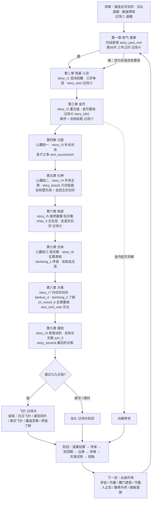

# 《废柴仙途》故事线总梳理（STORY）

> 范围：代码里实际存在的全部剧情——`src/events.js` 与 `src/content/*.js` 的 **367 个事件**（全部通过能力闸门、处于上线状态），加上 `src/logic/`（主线章节、宿敌、宗门、奇遇链、轮回、天劫）和 `src/ui/`（开场、高光过场、对决台词、飞升 / 坐化文案）里写死的剧情文本。
> 依据：分支 `redesign` @ `69da975`。设计文档（`docs/CONTENT.md`、`docs/DESIGN.md` §7、`docs/COMBAT_LOOT.md` §9）只作参考；两者不一致处以代码为准，并标 **〔与设计不符〕**。
> 写法：每个剧情点都标事件 id（反引号），flag 也用反引号。境界顺序：炼气(0) → 筑基(1) → 金丹(2) → 元婴(3) → 化神(4) → 炼虚(5) → 合体(6) → 大乘(7) → 渡劫(8) → 真仙(9，飞升)。“月”是游戏内的一个月（一个 tick）。
> 附录 A 是 367 个事件的完整索引（位置、条件、所属线），用来回查。

## 目录

1. [一页纸总览](#1-一页纸总览)
2. [主线：序章 + 九章](#2-主线序章--九章)
3. [老祖玄霄身世线](#3-老祖玄霄身世线)
4. [宿敌线](#4-宿敌线)
5. [人物羁绊线](#5-人物羁绊线)
6. [宗门线](#6-宗门线)
7. [奇遇链（10 条）](#7-奇遇链10-条)
8. [出身与轮回](#8-出身与轮回)
9. [其他带剧情的事件](#9-其他带剧情的事件)
10. [结局](#10-结局)
11. [问题清单](#11-问题清单)
12. [附录 A：事件总索引（367）](#附录-a事件总索引367)

---

## 1. 一页纸总览

### 1.1 世界观与核心设定

- **主角**：落霞城的少年（默认名林逸尘，可选男女），杂灵根，天剑宗外门弟子。开场同一天里被大师兄 **赵乾** 一脚踢下山门、被未婚妻 **慕容雪**（主角为女时是 **慕容轩**）当众退婚，对方约下“三年后落霞城论剑”。当夜在荒山破庙捡到一枚生锈的戒指（`src/ui/intro.js`）。
- **戒中老祖 = 玄霄剑仙**：三千年前的天下第一剑仙，只剩一缕残魂困在戒中；嘴毒、护短、好面子，记忆残缺（只记得二徒弟墨离持剑刺来）。他教主角修炼、借力、讲解，是主线的“导师”。
- **三千年前的旧案**（`src/events.js` 头注释 + `story_r6`）：
  - 玄霄渡劫时，**大徒弟陆天衡** 从背后偷袭，夺走《玄霄剑典》上卷，改名《天剑九式》开创 **天剑宗**——只偷到上半句，所以“九式从无第十式”，九式之后是“收”不是“杀”（`story_r3`、`ch_tianjian_1`）。
  - **二徒弟墨离** 那一剑刺向的是师父身后的陆天衡；他用断剑的剑镡熔成戒指，把师尊残魂封进去，自己背了三千年“弑师”骂名。墨家祖训只有一句：“问师祖，可曾信过墨离？”（`story_r4`）
  - 老祖的佩剑 **玄霄** 断成三截，流落黑风寨（镇寨之宝）、东海海眼（定海针）、陆天衡腰间（`ch_sword_*`）。上古剑冢是老祖旧居（`story_boss5`）。金刚寺的慧能当年路过，目睹了一切，从此闭口禅三千年（`ch_tianjian_5`）。
- **陆天衡** 活到今天，是天剑宗宗主、楚天阔的师父，终局反派；他自述“也是杂灵根、也被当废柴，剑典不传我，我只好自己拿”（`story_demon3`）、“因为他站得太高，从没回头看过我”（`tianheng_1`）。
- **主角的体质**：五色杂灵根在筑基时融成“混沌”，随境界四次觉醒（筑基初醒 → 元婴二醒 → 炼虚三醒 → 大乘“混沌圣体·大成”，`L.AWAKE`）。老祖说“三千年只在一个人身上见过”（`story_r1`，此人未揭晓，见问题清单）。
- **天下格局**：三大正宗（太虚剑宗 / 丹霞谷 / 玄天道宗，可拜入）+ 血煞魔宗（魔道第一宗，条件满足可拜入）；九宗榜另有昆仑仙宫、天剑宗、万法阁、金刚寺、御兽山。天骄榜 100 人，五位宿敌卡在不同名次：慕容 72、赵乾 45、楚天阔 12、血无涯 4、云无极 1。
- **更高处**：云无极败后说“上面还有人在看我们……只知道它们出题，从不改卷”（`yun_3`）；卖茶翁是“三千年前差半步飞升的茶痴”，留言“上面没什么好的，慢点长”（`ch_tea_5`）；星墟仙人下凡补天、回不去（`ch_star_*`）。这三处给多周目的“天道试炼”铺垫。

### 1.2 主角的成长弧

| 阶段 | 心境 | 关键节点 |
|---|---|---|
| 废柴 | 屈辱、嘴硬 | 被逐、退婚、破庙捡戒（序章）；约战前夜回答“赢了想干什么”（`story_pact_eve`，定第一份道心） |
| 立身 | 打脸、争口气 | 三年之约、入宗劈试剑石（`story_sect`）、压过赵乾 |
| 卷入旧案 | 被墨家与天剑宗同时盯上 | 墨无痕夜半夺戒（`story_r2`）、补全剑诀（`story_r3`）、半块玉简（`story_r4`）、祖师画像（`story_r5`） |
| 真相 | 替师父讨公道 | 玄霄真相（`story_r6`）、问剑天剑宗（`story_r7`）、了断陆天衡（`tianheng_2`） |
| 出师 | 独自上路 | 老祖诀别（`story_r8`）、空戒（`home_empty_ring`）、飞升前夜的访客（`story_ascend`）、飞升 |

贯穿全程的“道心”三倾向：狂 `k` / 稳 `w` / 仁 `r`（选项的 `dao` 字段），决定章末评语（`L.daoChapter`）、飞升评语（`L.daoEnding`）与部分称号；“因果”（`fx.karma`）记下你亏欠的人，会以寻仇、心魔、轮回折扣的形式回来（`src/logic/dao.js`）。

### 1.3 总流程图

旁支并行：六位人物的五心线（§5）、五位宿敌的恩怨线（§4）、宗门晋升与长老人脉（§6）、十条奇遇链（§7）都按境界与好感交错出现，在主线章节之间穿插。

---

## 2. 主线：序章 + 九章

章节数据在 `src/logic/quests.js`（`L.CHAPTERS`：每章一个主线目标 + 一串札记小任务）和 `src/logic/path.js`（目标卡、章末结算）。**当前章 = 第一个主线没完成的章，但不低于到过的最高境界**（`L.chapterNow`），所以章节基本和大境界一一对应；主线剧情本身由踏入境界时的 `realm:N` 触发键推出（`src/logic/cultivation.js`），同一触发键的后续剧情会在前一段结算后补发（`src/logic/chains.js`）。

| 章 | 名 / 境界 | 主线目标（`main.c`） | 章末奖励 | 本章主线剧情 | 高光过场 |
|---|---|---|---|---|---|
| 序 | — | — | — | 开场四页（`intro.js`） | ① 退婚 |
| 一 | 废柴 · 炼气 | 赢下三年之约（输了改为“论道上击败慕容”） | 灵石 800 | `story_pact_eve` | ④ 三年之约、② 戒中剑意 |
| 二 | 入宗 · 筑基 | 内门弟子 + 天骄榜前 60 | 灵石 1500、破境丹 2 | `story_r1`、`story_sect` | ③ 破境（筑基全版）、⑤ 入宗 |
| 三 | 金丹 | 真传弟子 + 击败赵乾 | 10 倍月收入、天材地宝 | `story_r2`、`story_trib1` | ⑧ 金丹雷劫、⑦ 宿敌对视·赵乾 |
| 四 | 元婴 | 成为圣子 / 圣女 | 15 倍月收入、宝库任选 | `story_demon1`、`story_r3`、`sect_succession` | ③ 破境短版 |
| 五 | 化神 | 击败楚天阔 + 九宗会武压过天剑宗 | 20 倍、称号「剑压天剑」 | `story_demon2`、`story_r4`、`story_boss5` | ⑦ 宿敌对视·楚天阔、⑥ 斩首领 |
| 六 | 炼虚 | 击退来犯的天剑宗 | 25 倍、称号「山门之盾」 | `story_r5`、`zhao_3` | ⑨ 守山 |
| 七 | 合体 | 击败血无涯 | 30 倍、称号「魔道克星」 | `story_demon3`、`story_r6`、`tianheng_1`、`story_r6_mo` | ⑦ 宿敌对视·血无涯 |
| 八 | 大乘 | 成为宗主并带宗门登顶 | 40 倍、称号「万宗之主」 | `story_r7`、`tiankuo_4`、`tianheng_2`、`sect_lord_vote` | ③ 破境短版 |
| 九 | 渡劫 | 渡过飞升天劫 | — | `story_r8`、`yun_3`、`story_ascend` | ⑩ 飞升 |

### 序章：被逐、退婚、破庙

- **开场四页**（`src/ui/intro.js`）：① 天剑宗外门，“杂灵根也配修仙？滚出山门！”，被大师兄赵乾踢下山；② 同一天婚约被当众撕毁，慕容：“三年后落霞城论剑，你若敢来，我便让你输得心服口服。”主角：“莫欺少年穷！”；③ 当夜荒山破庙，锈戒发烫：“小家伙，老夫在戒中等了你三千年。”；④ 题眼：三年之约、天剑宗、天骄榜、宗门之巅、九九天劫后的白日飞升。
- 第 2 页换成 **过场① 退婚**（`cine2.js` `tuihun`）：“这门亲事，就此作罢。”→ 撕信 →“三年后，我来取回。”
- 起名、选性别后建档，日志：“在荒山破庙中盘膝坐下，仙途由此开始”。
- 转世后的开场换成出身开场文案（`L.ORIGINS[].open`，§8）。

### 第一章 废柴（炼气）

- **梗概**：在破庙洞府里修炼、第一次历练、第一次见访客；三年（第 36 月）后在落霞城擂台与慕容决战。
- **触发与事件**
  - 第 35 月 `pact_eve` → `story_pact_eve`「约战前夜」：老祖问“明天赢了，往后想干什么”——让他们抬头（狂，`pact_k`）/ 修到天上（稳，`pact_w`）/ 修破庙的顶（仁，`pact_r`，老祖：“本座在那儿，等了三千年”）。三个 flag 之后无人读取。
  - 本章可见的老祖日常：`home_rust`（擦戒指，≤ 金丹）、`home_elder_roast`、`home_old_dream`（梦见破庙里的自己）、`re_ring`（戒中传功）。
  - 炼气期专属：`ch_tea_1` 卖茶翁第一次支摊（只在炼气期，错过则本世没有这条链）。
  - 访客、途中遭遇从本章开始出现；退婚余波 `home_challenger`（“你就是那个被退婚的废物”）。
- **三年之约**（`L.pactDuel`，`src/ui/duels.js` `runPact`）：开打前过场④ 第一段“三年之期已到。”；对手台词“三年了，废物终究是废物”；老祖借力 ×2.4。
  - **赢**：慕容倒退十余步，“莫欺少年穷！今日之后，你我再无瓜葛。”；过场④ 第二段“这一纸休书，还你。”盖“胜”印；天骄榜跃升。
  - **输**：“天骄榜上，我们再见分晓！”；过场④ 输的定格“天骄榜上，再见。”；第一章主线改成“论道上击败慕容”（`path.js` / `quests.js`）。
- **第一次按大招**：过场② 戒中剑意，“小子，借你一剑。”
- **章末**：赢下约战（或论道击败慕容）。

### 第二章 入宗（筑基）

- **梗概**：筑基觉醒混沌灵根，三大宗门抢人，拜入宗门从劈柴开始，开始遇见六位人物与赵乾的骚扰。
- **事件**
  - `realm:1` → `story_r1`「混沌初醒」：杂灵根融成混沌，老祖声音发颤：“混沌圣体……三千年了，本座只在一个人身上见过。”追问则听见梦呓“……天衡，你那一剑，真狠啊。”（身世第一条线索，置 `st_r1`）。同时觉醒“混沌灵根·初醒”（仅弃徒）。
  - 三宗争徒弹窗（`tick.js` 的 `out.invite` → `boot.js showInvite`）：筑基后、约战结束后每 12 月来一次，老祖：“当年天剑宗把你踢下山，如今人家抢着要你。”；满足条件时血煞魔宗也递血帖。`home_recruit`（三宗使者同到）/ `re_recruit`（长老登门）是同一主题的访客事件。
  - `sect` → `story_sect`「入宗第一天」：管事师兄“杂灵根？柴房正缺个劈柴的”——一掌劈试剑石（对决，赢得称号「劈柴宗师」）/ 真去劈柴（斧斧暗合剑理）。魔门遗孤出身入正宗另有 `origin_moyi_wash`「洗心」。过场⑤ 入宗：“拜入某宗。”
  - 本章起出现：`home_zhao`（赵乾“还是那只脚”，筑基～化神）、`home_ex_letter`（慕容来信“另有苦衷”）、`mu_1`（赢下约战后慕容家封口钱，筑基～金丹）、六位人物的初遇（§5）、`home_elder_tale`（老祖讲两个徒弟）。
- **章末**：内门 + 天骄榜前 60。

### 第三章 金丹

- **梗概**：结丹当夜墨家后人来夺戒；第一次渡雷劫；在宗门成为真传，在论道台上踩过赵乾。
- **事件**
  - `realm:2` → `story_r2`「夜半黑衣」：黑衣人指尖触到戒指：“给我。你不知道里面关着什么。”老祖只吐出两个字：“墨家。”拔剑逼退 / 质问来意，都会得知他叫墨无痕（`st_mo_seen`，开启墨无痕线）。
  - 第一次雷劫（金丹三道雷）→ 过场⑧ 金丹雷劫“金丹，成。”→ `trib:1` → `story_trib1`「渡劫阵图」：老祖丢来旧阵图，“本座当年渡劫……算了，没渡完。”追问“您没渡完？”得“雷落下来时，背后有点凉”（`trib_hint`，伏笔，无人读）。给阵图 `f_dujie`。
  - 升真传（`srank:2`）→ `sect_duty_pick`「五堂抢人」选职司；真传起每 24 月有拜师的孩子（`sect_candidates`，§6）。
  - 赵乾线：`zhao_1`（让摊，金丹～元婴）、`exp_swords_zhao`（剑泉）、`sect_tianjian_letter`（战书），论道第一次碰上他时过场⑦“当年踢你下山，今天照样！”。
  - 墨无痕：`mo_1`「墨色剑帖」（后山十招）；老祖旧剑：`ch_sword_1`「剑锈」（戒指是剑镡熔的）。
- **章末**：真传 + 击败赵乾（击败只记 `beat_zhao`，没有专门的剧情事件，见问题清单）。

### 第四章 元婴

- **事件**
  - 元婴雷劫前先过 **心魔劫·一**（`demon:1` → `story_demon1`）：心魔翻出本世第一笔没了的因果（没有因果就是“被逐出山门那天”，`L.demonQuestion`）；还这么选 / 换一种选法（了结一条因果）/ 一剑斩它。结果 `demon1_firm` / `demon1_waver` 让这次雷劫 ±5%。
  - `realm:3` → `story_r3`「残缺的剑诀」：赵乾上门以天剑九式削平半座山头；老祖冷笑“只偷了上半句，下半句在本座这里”。当场补全（得称号「偷师的是你」）/ 含笑收礼（老祖：“教过的，都教过的。”）。都得战技《天剑九式》并置 `st_sword_flaw`。觉醒“混沌灵根·二醒”。
  - 圣子之争前夜（`sect:heir`）→ `sect_succession`「三处灯火」：站哪位长老一边，或谁也不站（`heir_none`）；之后与原圣子（太虚剑宗萧凌风 / 苏清寒、丹霞谷丹红袖、玄天道宗陆知白、血煞魔宗血无涯，`L.SECT_HEIR`）对决晋升。
  - 本章起：`home_heart_demon`（心魔退婚旧景）、`home_murong_gift`（慕容家大管事来擦地）、`exp_palace_ex`（仙府传承殿撞见慕容）、`mu_3` / `mu_4`（慕容恩怨分支）、`tiankuo_1` / `home_chu_tiankuo`（楚天阔初现）、`xue_1` / `exp_blood_ambush`（血无涯盯上你）、`mo_2`（墨无痕救你）、`ch_tea_4`。
- **章末**：圣子 / 圣女。

### 第五章 化神

- **事件**
  - **心魔劫·二**（`story_demon2`）：心魔是你没选的那位道侣候选（没有道侣时是老祖：“废柴，就凭你也想化神？”）。
  - `realm:4` → `story_r4`「半块玉简」：墨无痕拍出半块玉简：“祖训只有一句——问师祖，可曾信过墨离？”老祖：“那个逆徒，也配问？”只记得墨离持剑刺来；另外半块在天剑宗（`st_half`）。
  - 首杀剑冢守墓人（`boss:5`）→ `story_boss5`「万剑低眉」：漫山残剑剑尖朝下拜锈戒，“老伙计们……本座回来晚了。”（`st_stele`）；过场⑥ 斩首领。
  - `mo_3`「问师祖」（化神～炼虚）、`mo_q2`、`ch_mo_*` 墨家遗书（§7）把墨离的真意一封封揭开。
  - 第一次和楚天阔对决：过场⑦“弃徒，也配与我交手？”。击败后开启 `ch_tianjian`（天剑宗旧案链）、`tiankuo_2`、`tiankuo_5`。
  - 化神起：新秀登场（`new_1`～`new_4`）、`home_xue_invite`、`xue_2`、`yun_1`、`chu_5` / `bai_5`（人物“出远门”的事件）。
- **章末**：击败楚天阔 + 九宗会武压过天剑宗。

### 第六章 炼虚

- **事件**
  - `realm:5` → `story_r5`「祖师画像」：楚天阔压境，祭出天剑宗祖师画像逼你交出“邪戒”，老祖一字一顿：“陆、天、衡。本座的好大徒弟。”一剑斩画（夹层掉出另半块玉简）/ 当众质问“天剑九式为何从无第十式”。置 `st_lu`。觉醒“混沌道体·三醒”。
  - 满足“真传以上 + 炼虚”时（`rivals2.js warEve`）排定天剑宗来犯，提前 6 月 `war_eve:tianjian` → `zhao_3`「无名信」（需 `zhao_owes`，即放过赵乾或恩怨 ≤ −40）：照信布防（`raid_intel`，来犯战力 ×1.3）/ 烧了它。
  - 天剑宗来犯（`L.sectWar`）：赢则过场⑨ 守山“山门在，我在。”；输了 24 月后再来。`tianheng_1` 选“假意答应”会再推迟 24 月。
  - `sect_vein_3`（九宗分脉）、`ch_tianjian_3`（赵乾的半句话）。
- **章末**：击退天剑宗。

### 第七章 合体

- **事件**
  - **心魔劫·三**（`story_demon3`）：心魔是陆天衡：“我也是杂灵根，也被当废柴……你我，本是同一种人。”我不推人 / 也许一样（了结一条因果）/ 拔剑（天剑九式对下半句，漏出“一缕三千年前的雷光”）。
  - `realm:6` → `story_r6`「玄霄」：两块玉简合一，三千年前重现——陆天衡背后偷袭，墨离那一剑刺的是他，墨离封师尊残魂入戒、自背骂名（`st_truth`）。唤声玄霄剑仙（灵根 +1）/ 默默陪着；都得《玄霄心诀》、墨无痕好感 +10。老祖：“本座骂了那孩子三千年……替本座，给墨家后人倒杯酒。”
  - 同一触发键接着出：`tianheng_1`「隔空传音」（陆天衡以宗主之位换戒指：骂回去 / 假意答应 `raid_delay` / 问“为什么”得 `tianheng_why`）；`ch_tea_5`（卖茶翁最后一碗，需前四步）；`story_r6_mo`「错字之后」（需墨家遗书链 `mo_memory`）。
  - 本章：`mo_4`「三千年」（墨无痕摘面巾）、`home_yun_chess`、`exp_chaos_yun`、`sect_war_xuesha`（正魔大战）、`ch_tianjian_4` / `ch_tianjian_5`。第一次和血无涯对决：过场⑦“正道蝼蚁，也配？”
- **章末**：击败血无涯（同样没有专门的击败剧情）。

### 第八章 大乘

- **事件**
  - `realm:7` → `story_r7`「问剑天剑宗」：与墨无痕并肩上山，护山大阵应声而开（“这阵，是本座教的”），祖师碑前楚天阔横剑而立。碎碑正名（对决，墨离之名刻入正史，称号「清理门户」）/ 只讨公道（天剑宗改立墨离牌位，称号「以德服宗」）。都置 `st_justice`。觉醒“混沌圣体·大成”。
  - 同一触发键接着出：
    - `tiankuo_4`「拔剑」：陆天衡白衣负剑走出殿后，楚天阔挡在中间。按之前的楚天阔分支只显示一个选项：同行（`tiankuo_ally`）→ 他剑指师父（`tk_side_you`）；问剑山（`tiankuo_sect`）→ 他替天下看着（`tk_witness`）；都没有 → 他站在师父一边，出剑偏三寸（`tk_side_lu`）。
    - `tianheng_2`「了断」（同时是《老祖的旧剑》第 5 步）：陆天衡跪在碎碑间问“他后悔收我吗？”——一剑了断（因果 `tianheng`，老祖“……也好”）/ 废他修为 / 公之于众（需旧案链走完，楚天阔念旧档，陆天衡摘下宗主印放在墨离牌位前，称号「昭告天下」）/ 放他走。任一了断都解锁结局“师徒了断”（`hermit`）。
  - `ch_sword_6`「玄霄」：三截残剑齐了，老祖口述锻法，得器方《玄霄》与《玄霄剑典·剑卷》；“先祭剑”时老祖：“……这杯，敬阿离。”
  - 墨无痕收尾：`mo_5`「同门」（墨离佩剑“不悔”，叫你“小师叔祖”）、`mo_end`「往后」。
  - 太上长老时老宗主闭死关（`sect:lord`）→ `sect_lord_vote`「继任」；之后可升宗主。
- **章末**：宗主 + 宗门榜第一。

### 第九章 渡劫

- **事件**
  - `realm:8` → `story_r8`「最后一课」：劫云压顶，“第一道心劫，为师替你挡。”戒上锈迹剥落露出玉色。师父，别走（“头一回叫师父，偏挑这时候。破庙那夜捡到你，是本座最走运的事。”）/ 磕三个头。称号「玄霄传人」，置 `st_farewell`：从此老祖头像变淡、称“戒中余音”，不再讲解（`guide.js`、`scene.js`），玄霄“请老祖出手”失效（`gear.js`）；札记任务“听完老祖的诀别”给称号「戒中余音」。
  - `home_empty_ring`「空戒」：对着戒指絮叨，心口剑意“哼”了一声。
  - 云无极从渡劫初期起才肯上台（`L.RIVAL_WALL.yun`）；击败他（`beat:yun`）→ `yun_3`「天外有天」：“上面还有人在看我们……只知道它们出题，从不改卷。”（`trial_hint`、`yun_codex`，均无人读）。
  - 飞升雷劫前 `ascend` → `story_ascend`「最后的访客」：来敲门的是道侣 > 好感最高的知己 > 老祖（`L.ascendVisitor`），问“明天，还回来吗？”开门 / 隔门说话 / 别等我。
  - 九九天劫 → 过场⑩ 飞升“此去，天外见。”→ 飞升结算（§10）。
- **章末**：白日飞升；可留在此世，或再入轮回（§8）。

---

## 3. 老祖玄霄身世线

按玩家最早可能看到的顺序排列（同一境界内按触发先后）。“确定”= 主线必出；“可选”= 访客 / 历练 / 链，可能错过。

| # | 何时 | 事件 | 揭示的线索 | 必出？ |
|---|---|---|---|---|
| 1 | 开场 | `intro.js` | 破庙锈戒，“老夫在戒中等了你三千年” | 确定 |
| 2 | 炼气～金丹 | `home_rust` | 戒指的“锈”不许擦——“岁月的包浆”；擦掉一块露出玉色 | 可选 |
| 3 | 筑基 | `story_r1` | 混沌圣体“只在一个人身上见过”；梦呓“天衡，你那一剑，真狠啊” | 确定 |
| 4 | 筑基～炼虚 | `home_elder_tale`（需 `st_r1`） | 收过两个徒弟：大的稳重周全，小的又倔又闷；“看人这事，本座不如你” | 可选 |
| 5 | 金丹～大乘 | `realm_elder_mark`（秘境） | 石壁“玄霄到此一游”，“那时候身边还跟着两个徒弟” | 可选 |
| 6 | ≤ 炼虚 | `exp_tomb_mural`（落日古墓） | 壁画：白衣剑仙渡劫，一徒持剑向前，一徒面目被刮去 | 可选 |
| 7 | 金丹 | `story_r2` | 墨家人来夺戒，“你不知道里面关着什么” | 确定 |
| 8 | 金丹～大乘 | `mo_1`、`mo_2` | “戒指里那位的话，别全信”；“天剑宗比我更想要那戒指——他们怕里面的东西开口”；“我家三千年的骂名，系在它身上” | 可选 |
| 9 | 金丹起 | `story_trib1` | 老祖渡劫“没渡完”，“雷落下来时，背后有点凉” | 确定（第一次雷劫后） |
| 10 | 金丹起 | `ch_sword_1` | 戒指是剑镡熔的；玄霄断成三截；剑冢是旧居 | 可选（链） |
| 11 | 元婴 | `story_r3` | 天剑九式只偷到上半句，下半句在老祖这里；“教过的，都教过的” | 确定 |
| 12 | 任意 | `ch_map_4` | 酒窖上的“勿偷喝”是“写给天衡和阿离看的” | 可选（链） |
| 13 | 剑冢首领首杀 | `story_boss5` | 万剑朝锈戒行礼，“本座的旧居”，断剑上半个“霄”字 | 首杀剑冢守墓人即出 |
| 14 | 剑冢 / 黑风寨 / 东海 | `ch_sword_2`～`ch_sword_4` | 空剑位幻象（山寨、海底、白衣人腰间）；镇寨之宝；定海针 | 可选（链） |
| 15 | 化神 | `story_r4` | 墨家祖训“可曾信过墨离”；老祖只记得墨离持剑刺来；半块玉简 | 确定 |
| 16 | 化神～炼虚 | `mo_3`、`mo_q2` | 一人一魂当面对质；“本座……不记得了，只记得那一剑” | 可选 |
| 17 | ≤ 炼虚起（墨无痕 60） | `ch_mo_1`～`ch_mo_4` | 剑穗死结只对戒指松开；请罪书“弟子明日要做一件大逆不道的事”（“明日”= 渡劫那日）；战书“陆师兄，你袖中藏的东西我看见了……我会站在你身后”；未写完的信，“霄”字少一点（老祖教错的）、“师尊残魂已入戒中”；老祖想起“阿离喊的是‘师尊小心’” | 可选（链） |
| 18 | 化神～大乘 | `tiankuo_1`、`tiankuo_2`、`ch_tianjian_1`～`ch_tianjian_2` | 楚天阔：“你那收势像天剑九式的第十式”；被凿过的祖师碑，凿痕下“玄霄门下……首徒陆天衡，次徒墨离”；“本座认得这凿法。是天衡的手” | 可选（链） |
| 19 | 炼虚 | `story_r5` | 天剑宗祖师画像就是陆天衡；另半块玉简 | 确定 |
| 20 | 炼虚～大乘 | `ch_tianjian_3`～`ch_tianjian_6` | 赵乾听见宗主对第九层说“师尊，那一剑，我不后悔”；第九层铁匣《玄霄剑典》上卷原本、末页“弟子知罪”；慧能证词“背后一剑是他大徒弟” | 可选（链） |
| 21 | 合体雷劫前 | `story_demon3` | 陆天衡的自辩：“我也是杂灵根……剑典不传我，我只好自己拿” | 确定 |
| 22 | 合体 | `story_r6` | **真相**：陆天衡偷袭，墨离刺的是他，墨离封魂背名 | 确定 |
| 23 | 合体 | `tianheng_1` | 陆天衡传音；“因为他站得太高，从没回头看过我。” | 确定 |
| 24 | 合体 | `story_r6_mo`（需 `mo_memory`） | 老祖想起最后那一剑“他刺偏了半寸——故意留了本座一缕残魂”（与 #22 冲突，见问题清单） | 可选 |
| 25 | 合体～大乘 | `mo_4` | “是为师错怪了阿离。”墨无痕对戒指磕三个头 | 可选 |
| 26 | 大乘 | `story_r7`、`tiankuo_4`、`tianheng_2` | 正名、陆天衡的结局 | 确定 |
| 27 | 大乘 | `ch_sword_6`、`mo_5`、`mo_end` | 玄霄重铸，“这杯，敬阿离”；墨离佩剑“不悔”；“玄霄门下，记名弟子墨无痕” | 可选 |
| 28 | 渡劫 | `story_r8`、`home_empty_ring` | 诀别；“破庙那夜捡到你，是本座最走运的事” | 确定 |

旁支：`home_library_note`（藏经阁旧心法上是老祖年轻时的旁批“此说不对”）、`origin_shoumu_gate`（“那扇门，本座也从里面敲过”）、`ch_tea_5`（老祖认出卖茶翁是三千年前的茶痴）、`ch_map_5`（老祖的酒窖，“还是这个味”）。

---

## 4. 宿敌线

机制：`src/logic/rivals.js`（天骄榜、论道、卡位）与 `rivals2.js`（恩怨 `st.grudge`，−100～100）。恩怨 ≥ 60：历练伏击（`rv_ambush_*`）、拍卖抬价、宗门战事带头；≤ −40：化敌为友（赵乾自动置 `zhao_owes`）。三位卡位宿敌各守一道境界关：赵乾金丹中期、楚天阔化神中期、血无涯合体后期；云无极渡劫初期才上台（`L.RIVAL_WALL`）。第一次与赵乾 / 楚天阔 / 血无涯对决前播过场⑦ 宿敌对视。论道台词在 `src/ui/duels.js` `RIVAL_LINES`；天骄榜快讯 `L.RIVAL_NEWS` / `L.RIVAL_QY`。

### 4.1 慕容雪 / 慕容轩（退婚之人，榜 72）

- **出场**：开场退婚（`intro.js`、过场①）→ 三年之约（第一章）。
- **余波**：`home_ex_letter`（来信“另有苦衷”，信纸熏香与退婚书同一种）、`home_murong_gift`（当年甩退婚书的大管事带八口箱子来擦地，元婴起）、`exp_palace_ex`（仙府传承殿狭路相逢，元婴起）、`story_rank12`（进前十二时慕容家贺礼原封退回，附言“当日之赐”）、`story_daolv`（结契大典上慕容家的贺礼）、`auc_rival`（恩怨 ≥ 20 时拍卖会隔空比价）。
- **恩怨分支**（需赢过约战 `beat_mu` 起步）：
  - `mu_1`「封口钱」（筑基～金丹）：收下（−10）/ 原样退回附“赏你”（+20）/ 问慕容本人（`mu_asked`：这是背着慕容送的）。
  - `mu_2`「狭路」（需 `mu_asked`，黑风岭 / 古墓）：出手救慕容（−30，`mu_saved`）/ 丢丹就走（−15）/ 抱手看（+10，“三年前你也是这么看我的”）。
  - **和解线**（恩怨 ≤ −40）：`mu_3`「婚书」（元婴起）——退婚真相：家里拿慕容换了天剑宗的庇护。收进抽屉（`mu_friend`）/ 烧了它（`mu_clear`，得慕容自己的玉佩）/ 去问慕容家（`mu_press`）。`mu_5`「桂花糕」：“天骄榜上，你别输给别人。”（`mu_friend`）。和解后不再在拍卖会抬价。
  - **寻仇线**（恩怨 ≥ 60）：`mu_4`「客卿」（七枚剑穗的客卿上门讨说法：打赢则慕容亲笔“到此为止”，−70）、`rv_ambush_mu`「剑阵」。
- **结局**：没有收尾剧情；`mu_saved`、`mu_press` 无人读。

### 4.2 赵乾（天剑宗大师兄，榜 45）

- **出场**：开场踢你下山；`home_zhao`「大师兄驾到」（筑基～化神，“还是那只脚”，还他一脚得「以脚还脚」）。
- **压过他**（第三章）：`zhao_1`「让摊」（金丹～元婴、未败）、`exp_swords_zhao`「冤家路窄」（剑泉）、`sect_tianjian_letter`（战书）、`realm_rival`「同困」（秘境里同困：联手 −20 / 趁他病 +30 / 各走各的）、`story_r3`（元婴上门示威）、`world_liuxing`（流星雨抢陨铁）。论道过场⑦与台词“当年一脚把你踢下山，今天照样！”/ 输后“师……师弟，当年是师兄有眼无珠！”
- **战后余波**：`zhao_2`「顶罪」（需 `beat_zhao`，葬剑渊）：宗里丢了东西栽在他头上——放他走（−30，`zhao_owes`：“我欠你的，我会还”）/ 押回天剑宗（+40，因果 `zhao_bounty`，`zhao_guide`）/ 逼问内情（丢的是记着三千年前一桩事的旧档，`clue_tianjian`）。
- **化敌为友**：`zhao_4`「蜡丸」（≤ −40：“天剑宗迟早动你的宗门，日子我替你盯着”）→ `zhao_3`「无名信」（天剑宗来犯前，左手写的信，最后一笔是赵乾惯用的那一钩）；`mo_q1` 可找他要天剑宗布防图；`ch_tianjian_3`「半句话」（落魄的赵乾卖出宗主那句“我不后悔”）。
- **寻仇**：`rv_ambush_zhao`「缚灵网」（≥ 60）；恩怨 ≥ 60 时带头来犯（`L.rivalLeads`）。
- **结局**：倒戈报信（`raid_intel`）。〔与设计不符〕CONTENT §10 写“否则带路”，代码里 `zhao_guide` 无人读，没有“带路”分支。

### 4.3 楚天阔（天剑宗圣子，榜 12）

- **出场**：`home_chu_tiankuo`「圣子战帖」（元婴～合体）、`tiankuo_1`「问剑」（元婴～大乘、榜前 30、未败：出剑后他看出“这收势是我宗的，又不是”，`tiankuo_doubt`）、`story_r5`（祭祖师画像）。快讯“楚天阔踏入炼虚，放言弃徒不过如此”。
- **对决**（第五章）：过场⑦“弃徒，也配与我交手？”；论道输后“我楚天阔……竟输给一个弃徒？！”
- **疑 → 查旧案**：`tiankuo_2`「凿碑」（需 `beat_chu`：帮他拓碑 `tk_rubbing` / 说出老祖的事 `tk_told`）、`ch_tianjian_1`～`6`（§7），`chu_q2`（他在论剑台上击败了楚狂）。
- **分支**：
  - `tiankuo_3`「逐出门墙」（需旧案链第 4 步）：“天剑宗，已经没有楚天阔了”——指条路（东边空山挂起“问剑山”，`tiankuo_sect`）/ 留下他（`tiankuo_ally`：“往后你去哪，我的剑跟着”）/ 劝他认错（+20，他转身走）。
  - `tiankuo_5`「同行」（恩怨 ≤ −40、已败他）：一起走（`tiankuo_ally`）。`tiankuo_ally` 让他成为 **第七位同伴**（`L.COMP_IDS` 的 `tian`，斩妖分数 +6）。
  - 寻仇：`rv_ambush_chu`「再问一剑」（≥ 60）。
- **结局**：`tiankuo_4`（大乘）站在你、天下或师父一边；`ch_tianjian_6` 他请求“那天，让我站在你旁边”；`tianheng_2` 公之于众时由他念旧档。`tk_side_*` 三个 flag 无人读。

### 4.4 血无涯（魔道圣子，榜 4）

- **出场**：`exp_blood_ambush`「血衣截杀」（元婴起，“混沌圣体，活的最好”）、`xue_1`「一份贺礼」（元婴～大乘、已入宗：送来让你劈柴的管事师兄人头——退回 / 收下（因果 `xue_head`，`xue_gift`）/ 安葬）、`home_xue_invite`「魔道请柬」（化神起，“正道容不下你，魔道可以”）、`xue_2`「血池垂钓」（化神起，钓着一个正道弟子：救人 / 拿剑纹换 / 转身走开（因果 `xue_bait`））、`sect_war_xuesha`「正魔大战」（合体起，阵前点你出战）。
- **对决**（第七章）：过场⑦“正道蝼蚁，也配？”；论道输后“此人……不可力敌，撤！”
- **战后**：`xue_3`「池底之火」（需 `beat_xue`：血池底烧着偷来的丹火，`clue_fire`）；化敌为友 `xue_4`「血书」（≤ −40：魔门要拿你炼丹的名单，`xue_list`）；寻仇 `rv_ambush_xue`「人偶」（≥ 60）。
- 魔门遗孤出身时，约战对手厉枭是“血无涯的跟班”。〔与设计不符〕CONTENT §10“魔门出身时是护短的师兄”没有对应事件；拜入血煞魔宗时圣子之争的对手正是血无涯（`L.SECT_HEIR.xuesha`）。

### 4.5 云无极（昆仑首徒，天下第一，榜 1）

- **出场**：`story_rank12`（进前十二时万里外看你一眼：“我在榜首等你”）、`yun_1`「盲棋」（化神起，星墟：赢得 `clue_xingdou` / 掀棋盘看清他的五行 `yun_elem`）、`yun_2`「早了三年」（榜前 4：回或不回，`yun_line_*`）、`home_yun_chess`「榜首对弈」（合体起）、`exp_chaos_yun`「云端之人」（合体起，混沌凶兽）。
- **化敌为友 / 寻仇**：`yun_4`「一子」（≤ −40）、`rv_ambush_yun`「拦路棋局」（≥ 60，“今年别再往上走了”）。
- **对决**：渡劫初期起才肯上台，之后始终压你一头；论道台词“我在榜首等你很久了”/“好剑。天下第一，是你的了。”
- **结局**：`yun_3`「天外有天」（`beat:yun`）——给多周目天道试炼铺垫，但 `trial_hint`、`yun_codex` 无人读。

### 4.6 新秀（化神起，每 36 月一位）

`rivals2.js` 的新秀从你下方 20 名起每届论道 +8 名往上追：

- `new_1`「后起之秀」（`rookie:appear`）：“三年之内，我踩着{name}上去”，十六岁少年；去看他一眼得知其五行（`rookie_seen`）。
- `new_2`「登门约战」（`rookie:near`，追进 5 名内）：应战（打压）/ 指点三招（`rookie_taught`）/ 闭门不见（称号「缩头真人」）。
- 追到身后时强制一战（界面 `runRookie`）：指点 → 友善路人，之后每 24 月可能托人送礼；打压赢 → 得他法宝上的一条词条，他的恩怨 60 进“仇家池”（`rv_ambush_rk`「战书」）。
- `new_3`「跪门」（`rookie:beaten`）：赠功法（`rookie_gift`）/ 收下他（真传起，`rookie_disciple` → 变成一名徒弟）/ 赶他走。
- `new_4`「冒名」（`rookie:trouble`，指点后 24 月）：他报你名号砸了赌坊——认账（`rookie_loyal`）/ 不认（`rookie_spurned`）/ 亲自去一趟。
- 注意：这四件是 `story` 事件，引擎对 story 事件永远只出一次，所以 **只有第一位新秀有剧情**（见问题清单）。

### 4.7 陆天衡（天剑宗宗主，终局反派）

只在主线与旧案链出现：`story_r1`（梦呓）→ `story_r5`（画像）→ `story_demon3`（心魔）→ `story_r6`（真相）→ `tianheng_1`（传音，`raid_delay` 让天剑宗来犯推迟 24 月）→ `tiankuo_4`（走出殿后）→ `tianheng_2`（四种了断：`tianheng_dead` / `tianheng_crippled` / `tianheng_exposed` / `tianheng_spared`，任一解锁结局“师徒了断”）→ `ch_sword_6`（第三截玄霄“从陆天衡腰间解下”）。

---

## 5. 人物羁绊线

`src/logic/npc.js` / `people.js`：好感 0～100，每 20 一颗心——一心相识、二心来访（委托一）、三心知己（永久加成，60 时触发 `npc:<id>:60`）、四心同行（可选为历练同伴；委托二）、五心终章。道侣只有苏 / 夜，二选一（`fx.daolv`，`L.daolvBlocked`：天道试炼“孤星”、功法“太上无情”会挡）。结成道侣触发 `story_daolv`「结契之礼」，第一次双修触发 `pp_sx_su` / `pp_sx_ye`。人物来访时可送礼（喜好 ♥ / ✕ 是发现表）。各人还有一条“顺路来访”（`pp_*_drop`，冷却 12 月）和一条“同伴途中”（`pp_*_trip`，带他历练时）的闲笔。

委托（`L.PQ`，二心 / 四心各一件，完成好感 +15）：苏「药篓」「药箱」→《回春剑诀》；夜「不问用途」「秘境旧账」→《血遁》；楚狂「比剑」「首领」；葛老「上品」「新方子」；白小九「好饿」「探险」→ 雪团灵狐；墨无痕「墨家旧物」→《敛息术》、「魂引」→ 墨家遗物。

### 5.1 苏青瑶 / 苏景行（丹霞谷医修，可结道侣）

| 阶段 | 事件 | 内容 |
|---|---|---|
| 一心 | `su_1`「采药人」（后山 / 黑风岭历练） | 被妖狼逼到崖边的医修，嘴硬手软，“诊金免了”→ `su_met` |
| 二心 | `su_2`「复诊」、`su_visit`「药香」、`pp_su_drop` | 黑汤药治暗伤（`su_tea`）；常来数落你 |
| 三心 | `su_3`「疫镇」（金丹起，好感 30） | 丹霞谷不拨药，求你帮忙：倾囊 / 斩毒蛟 / 爱莫能助（−10）→ `su_crisis` |
| 委托 | `su_q1`「病根」（好感 40） | 疫镇孩子入冬又咳，“还有一个肯陪我熬夜的人”（划掉了） |
| 四心 | `su_4`「药囊」（好感 60） | 针脚歪扭的安神药囊，“我在丹霞谷没有朋友。你算头一个”→ `su_bond` |
| 委托 | `su_q2`「不问来路」（好感 80） | 半夜借密室救一个血煞魔修 → 救活得 `mo_owe`（之后可入血煞魔宗） |
| 五心 | `su_5`「问心」（好感 90、无道侣） | 丹霞谷为苏定了亲：不许回去 → **道侣**；再给我些时间（−5） |
| 终章 | `su_end`「济世堂」（好感 90、炼虚起、非夜道侣） | 丹云婆婆点苏继任济世堂、从此不下山：留下来（`su_stay`）/ 送你回去（“下辈子，换你来找我”，`su_qianyuan`）/ 去丹霞谷要人（`su_tang`，“堂，可以搬”） |
| 被放弃 | `su_left`「一瓶药」、`pp_su_left2`「药箱」（夜成道侣后） | 门槛上一瓶改过方子、不苦的药；济世堂开了分号，药箱每年都来 |

### 5.2 夜璃 / 夜无殇（魔门圣宗，可结道侣）

| 阶段 | 事件 | 内容 |
|---|---|---|
| 一心 | `ye_1`「屋顶来客」（筑基起） | 房梁上喝你的酒：“听说落霞城出了个被退婚的废柴”，血玉令——魔门圣宗 → `ye_met` |
| 二心 | `ye_2`「挡箭牌」（历练）、`ye_visit`、`pp_ye_drop` | “我相好来了”；兜头一盆水和一桌魔域小吃（`ye_debt`） |
| 三心 | `ye_3`「血衣」（金丹起，好感 30） | 圣宗内乱，正道巡查使叩门：开门迎敌 / 藏进密室 / 让开门（−20）→ `ye_crisis` |
| 委托 | `ye_q1`「不许问」（好感 40） | 借两颗赤炎果炼爆气丹：给（结果可能是救了三十个孩子，也可能是一桩血案，因果 `ye_pill`）/ 问用途（“替我娘报仇”，`ye_truth`）/ 悄悄跟着 |
| 四心 | `ye_4`「灯会」（好感 60） | “我娘是被正道‘替天行道’的，那年我七岁。……骗你的”→ `ye_bond` |
| 委托 | `ye_q2`「血契」（好感 80） | 圣宗以戒指换夜的自由：做假戒（`ye_free`）/ 伸手让你拿 / 一起反出去（`ye_defect`） |
| 五心 | `ye_5`「赌约」（好感 90、无道侣） | 夜执掌圣宗，“你敢当着天下正道说要我”：我赌 → **道侣**（称号「正邪通吃」） |
| 终章 | `ye_end`「十年」（需魔门圣火链走完、好感 90、炼虚起、非苏道侣） | 火毒去了，寿元只剩十年：去东海求续命蛟珠（`ye_life` / `ye_ten`）/ 陪你看完（「十年灯」）/ 分你一半精元 |
| 被放弃 | `ye_left`「一把刀」、`pp_ye_left2`「红绳」（苏成道侣后） | 砸了埋三年的酒，留一把缠红绳的刀“好好过”；执掌圣宗后头一道令“不许门人再碰正道的孩子” |

魔门遗孤出身开局夜一心（她是当年把你塞进枯井的红衣孩子，`ch_fire_1m`）。

### 5.3 楚狂（剑痴散修）

`chu_1`「拦路剑痴」（后山 / 黑风岭 / 剑冢历练：“拔剑。”）→ `chu_2`「第七次约战」（“我没朋友。你算一个”，`chu_wine`）→ `chu_visit`「切磋」→ `chu_3`「围杀」（金丹起：他因说“天剑九式是残的”被天剑宗围杀，`chu_crisis`）→ `chu_q1`「借一式」（剑碑林，好感 40）→ `chu_4`「半截剑穗」（好感 60 触发：师父留的剑穗一刀两段，称号「生死之交」，`chu_bond`）→ `chu_5`「一剑之约」（化神起：闭死关前把毕生剑悟刻成玉简，论剑七日得天赋【先天剑骨】）→ `chu_q2`「三天」（好感 80：他在论剑台上输给楚天阔）→ `chu_end`「走一圈」（炼虚起：悟出自己的一式，下山走天下，称号「剑痴之友」，`chu_gone`）。另：`ch_map_3`（他拿第三片藏宝图垫桌脚）、`pp_chu_drop`「磨剑」、`pp_chu_trip`「劈开的石头」。

### 5.4 葛老（落魄丹师）

`ge_1`「门口醉汉」（“火候过了半分”）→ `ge_2`「赊酒钱」（`ge_wine`）→ `ge_visit`「蹭饭」→ `ge_3`「赌丹」（金丹起：丹霞谷执事骂他“偷丹方的丧家犬”，`ge_crisis`）→ `ge_q1`「赎人」（赊酒四十七坛，担保人是你）→ `ge_4`「旧事」（好感 55：偷丹方的是他徒弟，他替徒弟认了，`ge_bond`）→ `ge_5`「衣钵」（元婴起：传丹道得天赋【丹道奇才】）→ `ge_q2`「床底下」（丹霞谷八抬大轿来请：说他死了 / 劝他回去 / 请谷主亲来——丹云婆婆来吵了一夜，掉出一页丹经，直接置 `danjing_2`）→ `ge_end`「一炉旧丹」（炼虚起：六十年前与师弟阿青炼九转金丹炸炉，阿青没出来；今天是忌日——炼完那炉（九转秘方）/ 陪他去上坟（丹云已来过））。与丹云婆婆的旧情在《丹经七页》链里收束（§7）。丹童出身开局葛老一心，`origin_dantong_ash`。

### 5.5 白小九（化形灵狐）

`bai_1`「偷草贼」（啃秃灵田的小白狐，`bai_met`）→ `bai_2`「化形」（狐耳少女带翻丹炉，`bai_food`）→ `bai_visit`「报恩」→ `bai_3`「猎妖令」（金丹起：被关在集市铁笼里，`bai_crisis`）→ `bai_q1`「妖市的账」→ `bai_4`「全部家当」（好感 60 触发：攒了一百年的宝贝全给恩人，“小九以后是你的家人啦”，`bai_bond`）→ `bai_5`「青丘来信」（化神起：青丘使者说她是九尾天狐遗脉，须回族地觉醒、一去百年——让她去（得天赋【锦鲤附体】）/ 留下她）→ `bai_q2`「尾巴」（宗门怀疑你洞府养妖）→《狐族秘地》链（§7，雪见坡）→ `bai_end`「九尾」（后山 / 万妖山脉历练、好感 90：成九尾（守秘地，留一缕血脉化小狐，`bai_nine`）/ 跟我回家（`bai_stay`，称号「狐狸的家」）/ 你自己选）。飞升文案按 `bai_nine` / `bai_stay` 多一句（§10）。另：`pet_guard`（灵宠半夜按住偷草的她）。

### 5.6 墨无痕（墨家后人）

`story_r2`（夺戒，`st_mo_seen`）→ `mo_1`「墨色剑帖」（金丹～大乘：后山十招，“戒指里那位的话，别全信”，`mo_warn`）→ `mo_2`「黑衣过客」（元婴起：替你斩天剑宗刺客，`mo_save`）→ `story_r4`（半块玉简，`st_half`）→ `mo_3`「问师祖」（化神～炼虚）→ `mo_q1`「布防图」（元婴～合体：“总有一天，我要走上去”，`tj_map`）→ `mo_q2`「一句话」（“只要他亲口说一句——墨离没有弑师”）→《墨家遗书》链（§7）→ `story_r6`（真相，好感 +10）→ `mo_4`「三千年」（合体～大乘：摘面巾，“该谢罪的另有其人”，`mo_bond`）→ `story_r7`（并肩问剑）→ `mo_5`「同门」（大乘：墨离佩剑“不悔”，称号「小师叔祖」）→ `mo_end`「往后」（大乘：留下看门 / 陪你去上坟 / 做我师弟吧（称号「玄霄门下」））。另：`pp_mo_drop`「檐下」（“看他”）、`pp_mo_trip`「残碑」（被剑划了七道的“墨”字）。

---

## 6. 宗门线

### 6.1 宗门与入宗

- 可拜入：**太虚剑宗**（天下剑修圣地）、**丹霞谷**（丹道第一）、**玄天道宗**（道法正宗），以及 **血煞魔宗**（魔门遗孤出身、夜好感 ≥ 40、或 `su_q2` 救过的魔修欠你一条命 `mo_owe` 时才会递血帖，`L.sectJoinable`）。天剑宗是驱逐你的宗门，不可拜入。
- 入宗流程：筑基 + 约战结束后，三宗争徒弹窗每 12 月一次（老祖：“当年天剑宗把你踢下山，如今人家抢着要你”）；拜入后 `story_sect`（劈柴）、过场⑤；魔门遗孤入正宗另有 `origin_moyi_wash`；丹童入丹霞谷直接内门起步。天道试炼“无宗”不能入宗。
- 九宗会武：九宗各有代表与开场白（昆仑仙宫云无极、天剑宗楚天阔、血煞魔宗血无涯、万法阁诸葛千机、金刚寺慧能大师、太虚剑宗剑十三、玄天道宗玄微子、丹霞谷丹红袖、御兽山驭天风，`L.NINE`）。

### 6.2 晋升与宗门大事

外门 → 内门（筑基）→ 真传（金丹，`srank:2` 触发 `sect_duty_pick` 选职司）→ 圣子 / 圣女（元婴，前夜 `sect_succession`，对决原圣子：萧凌风 / 苏清寒、丹红袖、陆知白、血无涯）→ 长老（化神）→ 太上长老（合体）→ 宗主（大乘，前夜 `sect_lord_vote`）。天剑宗来犯（`war_eve:tianjian` → `zhao_3`，过场⑨）。真传起收徒（§6.5）。

| id | 标题 | 位置 / 触发 | 条件 | 梗概 |
|---|---|---|---|---|
| `sect_duty_pick` | 五堂抢人 | 剧情 `srank:2` | 已入宗 | 升真传当天五堂抢人：丹 / 器 / 战 / 执法 / 外事 |
| `sect_succession` | 三处灯火 | 剧情 `sect:heir` | 已入宗 | 圣子之争前夜三处灯火：站哪位长老一边（或谁也不站） |
| `sect_lord_vote` | 继任 | 剧情 `sect:lord` | 已入宗 | 老宗主闭关，三支签：听凭长老 / 还镇宗宝 / 不服上台 |
| `sect_traitor` | 火漆 | 洞府访客 | 已入宗；宗主起；一次 | 截下白头长老私通天剑宗的火漆信：当众拆 / 约他看云 / 将计就计 |
| `sect_frame` | 枕下的书 | 洞府访客 | 已入宗；真传弟子起；一次 | 执法堂查房前，枕下多了一本魔宗禁书 |
| `sect_lecture` | 轮值讲道 | 洞府访客 | 化神起；已入宗；长老起 | 轮值讲道：讲大道 / 手上功夫 / 世道人心，各讨一位长老欢心 |
| `sect_vault_new` | 库房耳语 | 洞府访客 | 已入宗；内门弟子起 | 哑巴管库执事透露下一批宝库好货 |
| `sect_junior_duel` | 不服来 | 洞府访客 | 已入宗；内门弟子起 | 同届弟子立牌“不服来” |

### 6.3 宗门日常事件（已入宗）

| id | 标题 | 位置 / 触发 | 条件 | 梗概 |
|---|---|---|---|---|
| `home_sect_chore` | 藏经阁轮值 | 洞府访客 | 已入宗 | 藏经阁轮值，顶层书架后有东西发光 |
| `home_sect_junior` | 求指点 | 洞府访客 | 金丹起；已入宗 | 外门杂灵根小弟子求指点，你写下《废柴真解》 |
| `home_sect_elders` | 抢徒大战 | 洞府访客 | 元婴起；已入宗 | 两位长老在你门口抢收亲传 |
| `sect_vein_1` | 灵脉现世 | 洞府访客 | 筑基起；已入宗 | 青石岭灵脉现世，与天剑宗、万法阁抢脉 |
| `sect_vein_2` | 截脉 | 历练途中 | 元婴起；已入宗；一次 | 截住血煞魔宗血阵抽脉 |
| `sect_vein_3` | 九宗分脉 | 洞府访客 | 炼虚起；已入宗 | 九宗会盟分灵脉，天剑宗长老讥你宗“靠弃徒撑门面” |
| `sect_poach` | 挖墙脚 | 洞府访客 | 金丹～大乘；已入宗；一次 | 万法阁深夜挖墙脚 |
| `sect_spy` | 细作 | 洞府访客 | 金丹起；已入宗 | 藏经阁里翻你笔记的血煞细作 |
| `sect_bully` | 护短 | 洞府访客 | 筑基～炼虚；已入宗 | 小弟子在坊市被天剑宗羞辱，护短讨说法 |
| `sect_marriage` | 联姻 | 洞府访客 | 元婴起；已入宗；无道侣 | 金刚寺俗家一脉上门联姻（失败时苏、夜冷脸来访） |
| `sect_secret_realm` | 秘境入口 | 历练途中 | 金丹起；已入宗 | 五宗弟子挤在秘境入口 |
| `sect_merchant_war` | 坊市商战 | 洞府访客 | 金丹起；已入宗 | 万法阁倾销丹药，亲自炼丹坐镇 |
| `sect_alliance` | 会盟 | 洞府访客 | 化神起；已入宗 | 金刚寺发起正道会盟，推你主盟 |
| `sect_war_xuesha` | 正魔大战 | 洞府访客 | 合体起；已入宗；一次 | 正魔大战：血无涯阵前点你出战 |
| `sect_tianjian_letter` | 天剑宗战书 | 洞府访客 | 元婴～合体；已入宗 | 赵乾署名的天剑宗战书 |
| `home_recruit` | 三宗抢人 | 洞府访客 | 筑基～大乘；未入宗 | 三宗使者同时上门抢人（“当年踢你下山时，可没人排队”） |
| `re_recruit` | 长老登门 | 洞府访客 | 未入宗 | 某大宗长老登门收亲传 |

血煞魔宗弟子不会碰上 `sect_war_xuesha`、`sect_alliance`（`MO_SKIP`）。

### 6.4 长老人脉（每宗三位，支持 0～100）

每宗三位长老两两理念相冲（送礼时对头 −2），各有两件事件：支持 20 时一件私事，支持 60 且真传起一件“两位长老相争、你来定”的事。≥ 40 得小恩惠，第一次到 80 得绝学。

| 宗门 | 长老（理念） |
|---|---|
| 太虚剑宗 | 凌虚子·掌门（剑即一切）、铁冶真人·器堂（器为剑骨）、柳含烟·执法（规矩大于天） |
| 丹霞谷 | 丹云婆婆·谷主（丹道济世）、药尘子·药园（草木有灵）、赤松客·外事（丹药就是买卖） |
| 玄天道宗 | 玄微子·掌教（道法自然）、守拙道人·藏经（厚积薄发）、清虚真人·观星（顺天应时） |
| 血煞魔宗 | 血河老祖·宗主（强者为尊）、鬼医薛三·药房（毒亦是药）、幽姬·细作（人心可用） |

| id | 标题 | 位置 / 触发 | 条件 | 梗概 |
|---|---|---|---|---|
| `jian_lingxu_1` | 输掉的剑 | 洞府访客 | 已入宗；凌虚子支持20+；一次 | 凌虚子二十岁输在剑冢的那把剑 |
| `jian_lingxu_2` | 第九层 | 洞府访客 | 已入宗；真传弟子起；凌虚子支持60+；一次 | 凌虚子要破格放你上剑阁第九层，柳含烟拍出门规 |
| `jian_tieye_1` | 一块陨铁 | 洞府访客 | 已入宗；铁冶真人支持20+；一次 | 铁冶真人缺一块天外陨铁 |
| `jian_tieye_2` | 一笔钱 | 洞府访客 | 已入宗；真传弟子起；铁冶真人支持60+；一次 | 宗门只批一笔大钱：修剑阁还是买矿 |
| `jian_liu_1` | 指认 | 洞府访客 | 已入宗；柳含烟支持20+；一次 | 柳含烟让你指认入宗第一天给你留饭的外门弟子 |
| `jian_liu_2` | 私卖 | 洞府访客 | 已入宗；真传弟子起；柳含烟支持60+；一次 | 器堂私卖法器，按门规办还是账目公开 |
| `dan_yun_1` | 试丹 | 洞府访客 | 已入宗；丹云婆婆支持20+；一次 | 丹云婆婆的新寒疫丹总得有人先吃 |
| `dan_yun_2` | 送与卖 | 洞府访客 | 已入宗；真传弟子起；丹云婆婆支持60+；一次 | 饥荒：三年存丹全送下山还是丹换米（赤松客反对） |
| `dan_yaochen_1` | 药园闹虫 | 洞府访客 | 已入宗；药尘子支持20+；一次 | 药园闹金甲虫，借灵宠吃虫 |
| `dan_yaochen_2` | 千年药王 | 洞府访客 | 已入宗；真传弟子起；药尘子支持60+；一次 | 千年药王开花，采还是留（丹云 vs 药尘子） |
| `dan_chisong_1` | 第三排 | 洞府访客 | 已入宗；赤松客支持20+；一次 | 赤松客要你坐第三排当托 |
| `dan_chisong_2` | 东坡 | 洞府访客 | 已入宗；真传弟子起；赤松客支持60+；一次 | 东坡盖铺面还是保三百年老参 |
| `dao_xuanwei_1` | 三问 | 洞府访客 | 已入宗；玄微子支持20+；一次 | 玄微子三问：做山、做水还是做剑 |
| `dao_xuanwei_2` | 出山 | 洞府访客 | 已入宗；真传弟子起；玄微子支持60+；一次 | 天剑宗吞小宗门，随掌教出山还是择吉时（清虚真人反对） |
| `dao_shouzhuo_1` | 第四十七页 | 洞府访客 | 已入宗；守拙道人支持20+；一次 | 守拙道人的书少了第四十七页——被你垫了炉脚 |
| `dao_shouzhuo_2` | 铁匣 | 洞府访客 | 已入宗；真传弟子起；守拙道人支持60+；一次 | 三百年禁术铁匣：封死还是师徒同看 |
| `dao_qingxu_1` | 命宫有星 | 洞府访客 | 已入宗；清虚真人支持20+；一次 | 清虚真人算你三月内有一劫 |
| `dao_qingxu_2` | 说与不说 | 洞府访客 | 已入宗；真传弟子起；清虚真人支持60+；一次 | 外门扫地弟子明年有死劫，说还是不说 |
| `mo_xuehe_1` | 血令 | 洞府访客 | 已入宗；血河老祖支持20+；一次 | 血河老祖的血令：提总给夜留酒的老酒保的头 |
| `mo_xuehe_2` | 分坛 | 洞府访客 | ≤大乘；已入宗；真传弟子起；血河老祖支持60+；一次 | 攻正道分坛：杀干净还是里应外合（幽姬有三个内线） |
| `mo_xuesan_1` | 一碗黑汤 | 洞府访客 | 已入宗；鬼医薛三支持20+；一次 | 鬼医薛三的一碗黑汤 |
| `mo_xuesan_2` | 十二个人 | 洞府访客 | ≤大乘；已入宗；真传弟子起；鬼医薛三支持60+；一次 | 血牢十二个正道俘虏：入药还是喂毒放回 |
| `mo_youji_1` | 一句假话 | 洞府访客 | 已入宗；幽姬支持20+；一次 | 幽姬让你给丹霞谷长老递一句假话 |
| `mo_youji_2` | 字条 | 洞府访客 | 已入宗；真传弟子起；幽姬支持60+；一次 | 圣火下落泄露，字条是薛三的字 |

丹霞谷三位长老与人物线交织：丹云婆婆是葛老的旧人（《丹经七页》）、点苏继任济世堂（`su_end`）、要圣火回家（`ch_fire_3`）；`realm_garden_thief` 里的丹红袖是谷中少主。血煞魔宗的幽姬是圣火之争的另一方（`ch_fire_3`），`mo_xuehe_1` 的老酒保“总给夜留一壶酒”。

### 6.5 徒弟

`src/logic/disciples.js`：真传 1 名、长老 2 名、宗主 3 名；每名徒弟各走一遍自己的事件（不受“story 只出一次”限制）。性情决定专属事件：莽 / 贪玩 → 闯祸，聪慧 → 发问，滑 → 倒卖，痴 → 走火，孤傲 → 顶撞，仁厚 → 散丹，贪玩 → 偷懒；另有冲关、挖角（小层 ≥ 8）、绑架（你有未了因果）、辞行（出师）。宗主后九宗会武改为三人战。新秀 `new_3` 也可收为徒。出师得“桃李”，计入轮回道果。

| id | 标题 | 位置 / 触发 | 条件 | 梗概 |
|---|---|---|---|---|
| `sect_candidates` | 拜师的孩子 | 剧情 `disc:candidates` | 已入宗 | 三个拜师的孩子：小牛犊 / 机灵鬼 / 闷葫芦 |
| `disc_first_day` | 第一个问题 | 剧情 `disciple` | ≤大乘；已入宗 | 新徒弟问“您当年真是被赶出来的吗”，定下严 / 宽 / 放养的基调 |
| `disc_trouble` | 破鼓 | 剧情 `disc:trouble` | 已入宗 | 徒弟敲破执法堂登闻鼓“想看看长老长什么样” |
| `disc_question` | 答不上来 | 剧情 `disc:question` | ≤大乘；已入宗 | “天地的灵气又从哪儿来？”你和老祖都答不上 |
| `disc_steal` | 亲炼 | 剧情 `disc:steal` | 已入宗 | 徒弟在坊市卖“你亲炼” |
| `disc_obsess` | 走火 | 剧情 `disc:obsess` | 已入宗 | 徒弟闭关走火，七窍渗血却在笑 |
| `disc_pride` | 半息空门 | 剧情 `disc:pride` | 已入宗 | 徒弟当众指出你收剑有半息空门 |
| `disc_kind` | 散尽的丹 | 剧情 `disc:kind` | 已入宗 | 徒弟把丹药全送了山下病人 |
| `disc_lazy` | 没砍的柴 | 剧情 `disc:lazy` | 已入宗 | 徒弟砍柴带回一只月牙兔 |
| `disc_poach` | 一张礼单 | 剧情 `disc:poach` | 已入宗 | 万法阁许你徒弟亲传之位 |
| `disc_break` | 冲关 | 剧情 `disc:break` | 已入宗 | 徒弟冲关前问“师父您忙吗” |
| `disc_avenge` | 带血的箭 | 剧情 `disc:avenge` | 已入宗 | 仇家绑走徒弟，“你欠我家的”（需有未了因果） |
| `disc_graduate` | 辞行 | 剧情 `disc:graduate` | 已入宗 | 徒弟结丹辞行，讨一样东西：赠剑 / 赠一句话 / 吃顿饭 |

---

## 7. 奇遇链（10 条）

`src/logic/chains.js`：链事件完成第 n 步自动置 `链短名_n`；开了头的链每 8 月“催”一次（访客 / 途中遭遇 55% 直接挑它，出身专属链 80%）；第 2 步起不再看境界上限；下一步是 `realm:N` 剧情而你已过了 N 时补进剧情队列；走完记入 `st.meta.chain`（跨世）并发“链成”奖励。

| 链 | 步数 | 起点 | 终点奖励 | 关联 |
|---|---|---|---|---|
| 藏宝图残片 `ch_map` | 5 | 任意历练途中（≤ 大乘） | 《寻龙诀》+ 剑 / 补槽法宝 | 老祖的酒窖；楚狂第 3 步 |
| 丹经七页 `ch_danjing` | 5 | 葛老好感 40 来访（丹童开局已完成第 1 步） | 九转金丹秘方、丹火阵图 | 葛老 × 丹云婆婆旧情 |
| 老祖的旧剑 `ch_sword` | 6 | 金丹起来访 | 器方《玄霄》、《玄霄剑典·剑卷》 | 身世线；第 5 步 = `tianheng_2` |
| 墨家遗书 `ch_mo` | 4 | 墨无痕好感 60 来访（≤ 炼虚） | 合体时 `story_r6_mo`、“潜渊”共鸣提示 | 身世线 |
| 狐族秘地 `ch_fox` | 4 | 白小九好感 80 来访（御兽遗脉开局已完成第 1 步） | 养兽阵图；`bai_end` 九尾分支 | 白小九终章 |
| 魔门圣火 `ch_fire` | 5 | 夜好感 60 来访（魔门遗孤开局即可） | 焚天诀、血遁（自己炼化时）；夜的去留 | 夜终章 `ye_end` |
| 天剑宗旧案 `ch_tianjian` | 6 | 击败楚天阔后（化神～大乘） | 楚天阔入伙；`tianheng_2` 多出“公之于众” | 身世线、楚天阔 |
| 东海借宝 `ch_sea` | 4 | 东海龙宫历练途中 | 《沧海无量》或龙鳞宝衣器方；蛟皇鳞 | 龙宫三太子 |
| 星墟仙人 `ch_star` | 4 | 天外星墟历练途中 | 鸿蒙残篇、星河剑器方；噬星核 | 天道试炼铺垫 |
| 卖茶翁 `ch_tea` | 5 | 炼气期来访（散修丹师必来） | 补最缺一槽的法宝；以后每条天道试炼道果 +5% | 天道试炼铺垫 |

### 7.1 藏宝图残片 `ch_map`
1. `ch_map_1`「半张图」（历练途中）：遗骨靴筒里半张羊皮，半个“玄”字；戒指一热。
2. `ch_map_2`「勿偷喝」（来访）：杂货铺老板柜底的第二片，拼出“勿偷喝”；夜里去偷记因果 `map_theft`。
3. `ch_map_3`「桌脚」（需认识楚狂）：楚狂垫了八年桌脚的第三片。
4. `ch_map_4`「本座的字」：老祖认出是自己的酒窖，“勿偷喝”是写给天衡和阿离的。
5. `ch_map_5`「老槐树下」：三千年的石窖，挑一样——剑 / 木匣 / 开一坛酒（“……还是这个味”），都得《寻龙诀》。

### 7.2 丹经七页 `ch_danjing`
1. `ch_danjing_1`「七之三」：葛老酒葫芦里掉出字迹清秀的一页。
2. `ch_danjing_2`「藏书楼」：丹霞谷《草木志》里夹的一页（`ge_q2` 请谷主也会直接得到这一步）。
3. `ch_danjing_3`「废纸一包」：赤松客拍卖的添头里有七之五、七之六。
4. `ch_danjing_4`「她的字」：页尾“云”字——丹霞谷谷主丹云，“那年她十九，老夫二十二”；丹经是两人一起写的，炸炉那年撕成七页。
5. `ch_danjing_5`「合页」：丹云婆婆带着剩下三页来，七页齐了；关门让二老独处 / 替葛老开口 / 请二老合炉 → 九转秘方 + 丹火阵图。

### 7.3 老祖的旧剑 `ch_sword`
1. `ch_sword_1`「剑锈」（金丹～大乘）：戒指的锈是剑气铁锈，戒指由剑镡熔成，玄霄断成三截。
2. `ch_sword_2`「空剑位」（剑冢）：九十九剑位空着正中一个，按上戒指见三道光——山寨、海底、白衣人的腰间（`sword_vision`）。
3. `ch_sword_3`「镇寨之宝」：黑风寨主雷彪扛来夜夜嗡鸣的红布长匣。
4. `ch_sword_4`「定海针」（东海）：海眼倒插的锈剑；硬拔掀潮记因果 `dinghai`。
5. `tianheng_2`「了断」（大乘主线）。
6. `ch_sword_6`「玄霄」（大乘）：三截齐，老祖口述锻法 → 器方《玄霄》+《玄霄剑典·剑卷》。

### 7.4 墨家遗书 `ch_mo`
1. `ch_mo_1`「墨色剑穗」：墨家三千年解不开的死结，对戒指松开一扣，里面三封蜡封信。
2. `ch_mo_2`「请罪书」：“弟子明日要做一件大逆不道的事”——“明日”就是师祖渡劫那日。
3. `ch_mo_3`「战书」：给“陆师兄”的信，“你袖中藏的东西，我看见了”（`mo_doubt`）。
4. `ch_mo_4`「错字」：没写完的第三封，“霄”字少一点；“师尊残魂已入戒中，弟子无能……”；页边小批“太虚与敛息同修，可潜于渊”（共鸣提示 `combo_hint_c18`），`mo_memory`。
→ 合体时 `story_r6_mo`「错字之后」。

### 7.5 狐族秘地 `ch_fox`
1. `ch_fox_1`「梦话」：“雪见坡……娘，雪见坡的雪还没化……”
2. `ch_fox_2`「妖市狐翁」：卖狐火灯的老狐狸认出“九尾家的，雪见坡最后那一窝”——九尾秘地三百年前封山，她娘是最后的守坡人。
3. `ch_fox_3`「狐尾为钥」：冰门要一条尾巴；你编一缕头发按进去也开了（“它认的是肯给的心”）。
4. `ch_fox_4`「雪见坡」：九座狐冢与冰雕九尾狐：“成了九尾就留下守坡；不成，就去做人吧。”
→ 链成得养兽阵图；`bai_end` 做最终选择。

### 7.6 魔门圣火 `ch_fire`
1. `ch_fire_1`「火毒」/ `ch_fire_1m`「井边的红衣」（魔门遗孤版：她就是当年把你塞进枯井的人）：圣火待久了会咬人。
2. `ch_fire_2`「丹火印」：圣火在炉里烧出丹霞谷开派祖师的炉印——魔门供了三千年的圣火是偷来的（去丹霞谷问则 `fire_leaked`）。
3. `ch_fire_3`「两封信」：幽姬要人和火回魔门，丹云婆婆要祖师的火回家。
4. `ch_fire_4`「池底火种」：血池之下九道血链锁着火种，另一头连着夜的心口。
5. `ch_fire_5`「火归何处」：还给夜（`fire_ye`，“魔门的圣火往后归我管”）/ 送回丹霞谷（`fire_dan`、`ye_left_mo`，“魔门，我不回了”）/ 自己炼化（《焚天诀》+《血遁》，`fire_self`）。
→ 解锁夜终章 `ye_end`。

### 7.7 天剑宗旧案 `ch_tianjian`
1. `ch_tianjian_1`「败者之问」（需 `beat_chu`）：楚天阔“你那收势像第十式”。
2. `ch_tianjian_2`「凿痕」：葬剑渊无字碑，“首徒陆天衡，次徒墨离”。
3. `ch_tianjian_3`「半句话」（炼虚起）：落魄赵乾卖出宗主那句“师尊，那一剑，我不后悔……”
4. `ch_tianjian_4`「第九层」（合体起）：藏经阁第九层的《玄霄剑典》上卷原本与“弟子知罪”（`tj_proof`）。→ 解锁 `tiankuo_3`。
5. `ch_tianjian_5`「闭口禅」：金刚寺慧能三千年闭口禅，老祖：“……小和尚？”他作证（`tj_witness`）。
6. `ch_tianjian_6`「昭告」：怎么公之于众你定——九宗会武上 / 私下逼宫（`tj_private`）/ 交给他定。→ `tianheng_2` 的“公之于众”选项。

### 7.8 东海借宝 `ch_sea`
1. `ch_sea_1`「失物」：龙宫丢了碧色龙睛珠。2. `ch_sea_2`「狼腹明珠」：后山独眼狼王三百年来肚皮发绿光。3. `ch_sea_3`「验货」：三太子嫌珠子一股狼味。4. `ch_sea_4`「借宝」：剑谱《沧海无量》/ 宝衣图 / 龙宫宴（称号「龙宫座上客」）。

### 7.9 星墟仙人 `ch_star`
1. `ch_star_1`「星中人影」。2. `ch_star_2`「今夕何年」：下凡补天裂缝一万两千年，上去的路断了。3. `ch_star_3`「凡间一物」：带一坛酒 / 一朵养魂花 / 一句真话。4. `ch_star_4`「星散」：不是上去，是散了；留下《鸿蒙》残篇与星河剑图。

### 7.10 卖茶翁 `ch_tea`
1. `ch_tea_1`「卖茶翁」（炼气）：破庙门口的茶摊，“后生，慢点长”。
2. `ch_tea_2`「一句闲话」（筑基～金丹）：“修仙修仙，你图个什么？”
3. `ch_tea_3`「雷火煮茶」（金丹～炼虚，雷劫后）：“最后一道雷，你躲了半步。不该躲。”
4. `ch_tea_4`「不该来的客」（元婴～炼虚）：冲你来的天剑宗刺客喝了碗茶，剑也不要了。
5. `ch_tea_5`「最后一碗」（合体主线触发）：“摊子归你了”；老祖认出“三千年前差半步飞升的那个茶痴”；条子背面“上面没什么好的。别学我，慢点长。”
每步的选项各置一个 flag（`tea_1_drink` 等），都没有被读取——设计里“每步一个看似无用的选择”的回收没做。

---

## 8. 出身与轮回

### 8.1 六种出身（`src/logic/samsara.js` `L.ORIGINS`）

第一世永远是弃徒；其余出身在轮回殿用道果点亮后，转世时可选。非弃徒出身：不播过场④；**含“退婚 / 婚约 / 婚书 / 慕容”字样的事件一律不出**（`L.originSkip`，共 13 个，见问题清单）；`{ex}` 换成约战对手的名字，天骄榜第 72 名也改名。

| 出身 | 开局 | 开场 | 约战（替代三年之约） | 专属 |
|---|---|---|---|---|
| 弃徒 `qitu` | 杂灵根，会觉醒 | 被逐、退婚、破庙锈戒 | 慕容雪 / 轩：三年之约（落霞城擂台） | 主线全套 |
| 丹童 `dantong` | 丹炉 2 级、葛老一心、3 格丹方 | 给葛老烧了七年炉火；丹霞谷少主丹红袖把你的丹倒进泔水桶；炉灰里滚出锈戒（老祖：“这丫头的火候，差得远”） | 丹红袖：丹会之约（丹霞谷斗丹台） | 《丹经七页》第 1 步已完成、`origin_dantong_ash`；入丹霞谷内门起步 |
| 魔门遗孤 `moyi` | 法器、夜一心、两条生来的因果 | 正道围剿血煞旧坛那夜被红衣孩子塞进枯井；十年后血无涯的跟班厉枭拎你出来定下血池之约；井底锈戒“剑是什么颜色，看握剑的人” | 厉枭：血池之约 | 《魔门圣火》（`ch_fire_1m`）、可入血煞魔宗、入正宗过 `origin_moyi_wash`、结局“魔道至尊” |
| 守墓人之后 `shoumu` | 法器、先天剑骨；筑基前不能开灵田 | 世代守着剑冢外的祖坟；黑风寨少寨主雷豹要坟地；父亲临终给你锈戒 | 雷豹：祖坟之约 | 上古剑冢筑基开放；`origin_shoumu_gate`（筑基夜祖坟碑裂出剑冢钥匙） |
| 散修丹师 `sanxiu` | 灵石 +300、卖价 +15%；不觉醒 | 坊市最末一间铺面；恶霸钱通劈了你的木牌；柜台缝里抠出锈戒 | 钱通：铺面之约 | 《卖茶翁》必来、`origin_sanxiu_rent`；可不入宗（货架 +2） |
| 御兽遗脉 `yushou` | 月牙兔、驭兽诀、名册 +1、自身战力 ×0.9 | 御兽山旁系只剩一只兔子；少主驭天风骑白狼吓得兔子钻灶膛；兔子叼出锈戒、梦见九尾白狐 | 驭天风：驭兽之约 | 《狐族秘地》第 1 步已完成、`origin_yushou_dream` |

各约战的开场、对手台词、胜负文案在 `L.ORIGINS[].pact`（`intro / quote / win / lose`）。约战前夜非弃徒另有 `origin_pact_eve`「约前一夜」（“这一世换了活法，可人还是那个人”）。

### 8.2 轮回流程（`src/ui/life.js`）

一世结束的三种方式：**飞升**（渡过九九天劫，可留在此世再选“再入轮回”）、**坐化**（寿元耗尽或天道试炼“限时”第 480 月到）、**兵解**（金丹起在人物页主动散功，二次确认）。之后依次：道果结算（`L.daoFruit`：境界、榜名、宗门、首领、知己、道侣、成就、飞升 +500、图鉴、秘境、桃李、道基、了结因果；× 天道试炼系数 × 未了因果每条 −2%）→ 传承（一门圆满功法 / 一条器灵词条 / 一只五心灵宠血脉）→ 轮回殿（宿慧、根骨、家底、前世法宝、老祖的记性、命格多一选、气运，及五个新节点、五个出身）→ 出身 → 命格（天赋三选一 / 四选一）→ 天道试炼 → 投胎 → 出身开场。

- **天道试炼**（可多选，道果系数相加；走完卖茶翁链后每条再 +5%）：寿元减半、老祖沉睡（没有护法与借力）、仇家遍地（天骄榜对手 ×1.25）、清贫、限时（480 月不飞升即坐化）、五行缺一、孤星（不能有同伴与道侣）、无宗。
- **跨世保留**：过场“看过”（不再自动播）、奇遇链最好进度、图鉴、宿敌资料、送礼喜好、轮回殿、传承、卖茶翁提示。
- **剧情上的变化**：每一世事件记录清零，弃徒出身的主线逐字重演；“老祖的记性”只给数值效果（首次大突破护法必成、约战借力 ×1.5），没有“老祖记得你”的台词；坐化时老祖：“别灰心。老夫护住你一缕真灵，带着这一世的感悟，再来一次！”

---

## 9. 其他带剧情的事件

宿敌、人物、宗门、链、主线之外的事件。表中“条件”列由脚本从事件字段生成（境界、flag、季节、大势等）。

### 9.1 老祖日常与洞府余音

| id | 标题 | 位置 / 触发 | 条件 | 梗概 |
|---|---|---|---|---|
| `home_elder_roast` | 老祖点评 | 洞府访客 | ≤大乘 | 老祖骂你打坐像发呆；虚心听骂得理经，顶嘴赢了多教一手、输了听他跑调唱清心咒 |
| `home_elder_tale` | 老祖讲古 | 洞府访客 | ≤炼虚；需 `st_r1`；一次 | 老祖讲古：收过两个徒弟，大的周全、小的倔闷——“看人这事，本座不如你”（身世伏笔） |
| `home_rust` | 擦戒指 | 洞府访客 | ≤金丹 | 拿醋擦戒指，老祖大怒“这叫包浆”；擦掉一块露出玉色（ch_sword 的前戏） |
| `re_ring` | 戒中传功 | 洞府访客 | ≤大乘 | 戒中传功：老祖夜里传一门新心法 |
| `home_old_dream` | 旧梦 | 洞府访客 | ≤元婴；一次 | 梦见破庙里的自己问“我们赢了吗”，道心澄明 |
| `home_empty_ring` | 空戒 | 洞府访客 | 需 `st_farewell`；一次 | 诀别之后对着空戒指说话，心口剑意轻轻一颤（老祖余音） |
| `home_library_note` | 旁批 | 剧情 `build:library` | ≤大乘 | 藏经阁旧心法上的旁批，是老祖年轻时的字 |
| `home_plot_full` | 杂货铺 | 剧情 `plot_full` | ≤大乘 | 洞府没地了，老祖教你拆一座重建 |

### 9.2 洞府访客·世情杂事

| id | 标题 | 位置 / 触发 | 条件 | 梗概 |
|---|---|---|---|---|
| `home_heart_demon` | 心魔 | 洞府访客 | 元婴起；一次 | 入定见退婚旧景，“你骨子里还是废物”；看完得天赋【道心坚定】 |
| `home_deviation` | 岔气 | 洞府访客 | 筑基起 | 行功岔气，服丹疏导 / 硬压拓经脉 / 散功保命 |
| `home_purple_qi` | 紫气东来 | 洞府访客 | 筑基起 | 紫气东来，静心吐纳或鲸吞（失败得称号“紫气嗝王”） |
| `home_storyteller` | 说书人 | 洞府访客 | 金丹起 | 说书人把你编成《废柴逆袭录》 |
| `home_merchant` | 祖传秘宝 | 洞府访客 | ≤大乘 | 游商卖“上古破碗”，碗底或是残功，或是“王记面馆” |
| `home_crane` | 落难仙鹤 | 洞府访客 | — | 落难仙鹤，治好得谢礼或收作灵宠 |
| `home_thunder` | 雷雨夜 | 洞府访客 | 金丹起；一次 | 雷雨夜老松孕雷击灵木：冒雷取木 / 借雷淬体 |
| `home_fans` | 门庭若市 | 洞府访客 | 金丹起 | 成名后门庭若市，摸头收费或闭门谢客 |
| `home_alchemy` | 开炉 | 洞府访客 | — | 手痒自己开炉，炸炉得称号“炸炉宗师” |
| `home_neighbor` | 夜半打铁 | 洞府访客 | 一次 | 隔壁新邻居半夜打铁（之后可做铁匠） |
| `re_enl` | 观云有悟 | 洞府访客 | — | 观云顿悟，修为大涨 |
| `re_cave` | 古修洞府 | 洞府访客 | — | 山雨冲出古修洞府，搜得灵石丹瓶 |
| `re_rain` | 天降灵雨 | 洞府访客 | — | 天降灵雨，吐纳或浇田 |
| `re_pill` | 游方丹师 | 洞府访客 | — | 游方丹师留下一枚破境丹 |
| `re_bandit` | 劫修夜闯 | 洞府访客 | — | 劫修夜闯洞府，斩之或破财 |
| `re_fairy` | 仙子落难 | 洞府访客 | — | 救下落难仙子，得一袋灵石 |
| `re_beast` | 门口的小兽 | 洞府访客 | — | 门口受伤小兽，疗伤后成灵宠 |

### 9.3 历练途中

| id | 标题 | 位置 / 触发 | 条件 | 梗概 |
|---|---|---|---|---|
| `exp_forest_fruit` | 守药妖兽 | 历练途中（后山野林/万妖山脉） | — | 铁背熊守朱果，偷摘或打服 |
| `exp_forest_cub` | 草窠幼兽 | 历练途中（后山野林/万妖山脉） | 一次 | 母兽死于修士剑下，收养幼兽或追凶（皆得灵宠） |
| `exp_hill_toll` | 此山是我开 | 历练途中（黑风岭） | — | 独眼匪首拦路收买路财，黑吃黑或反劫 |
| `exp_hill_caravan` | 被劫的商队 | 历练途中（黑风岭） | — | 救被劫商队，或坐等捡漏（小姑娘的哭声） |
| `exp_tomb_coffin` | 青铜棺 | 历练途中（落日古墓） | — | 青铜棺“承吾因果”——其实是怕寂寞 / 有机关 |
| `exp_tomb_ghost` | 残魂遗愿 | 历练途中（落日古墓） | 一次 | 八百年书生残魂托你去看城南柳树下的坟 |
| `exp_tomb_mural` | 壁画 | 历练途中（落日古墓） | ≤炼虚；一次 | 壁画：白衣剑仙渡劫，身后一徒持剑、一徒面目被刮——身世伏笔 |
| `exp_blood_pool` | 血池 | 历练途中（血煞秘境） | — | “九死一生”的血池，其实挺舒服 |
| `exp_blood_ambush` | 血衣截杀 | 历练途中（血煞秘境） | 元婴起 | 血无涯的血衣人截杀“混沌圣体” |
| `exp_swords_pull` | 拔剑 | 历练途中（上古剑冢） | — | 剑丘古剑，拔起即认主 |
| `exp_abyss_voice` | 渊底低语 | 历练途中（九幽魔渊） | — | 魔渊里最想听的那个声音诱你下台阶（魇魔） |
| `exp_abyss_flower` | 幽冥花 | 历练途中（九幽魔渊） | 一次 | 幽冥花：自己炼化或救魔气蚀心的小宗少主 |
| `exp_sea_clam` | 千年蚌精 | 历练途中（东海龙宫） | — | 千年蚌精，讲笑话换明珠 |
| `exp_sea_prince` | 龙宫赌斗 | 历练途中（东海龙宫） | 化神起 | 龙宫三太子赌斗（ch_sea 里他还会再出现） |
| `exp_sea_wreck` | 沉船 | 历练途中（东海龙宫） | — | 沉船里的守财墨章，以物易物或偷一件 |
| `exp_stars_core` | 坠星 | 历练途中（天外星墟） | — | 将熄的星核，冲进去炼化或远远吐纳 |
| `exp_stars_immortal` | 仙人遗蜕 | 历练途中（天外星墟） | 炼虚起；一次 | 仙人遗蜕求归葬人间，葬之得灵根 +1 |
| `exp_palace_puppet` | 守门傀儡 | 历练途中（太古仙府） | — | 守门傀儡三问“吾主最爱吃什么”——红烧肉 |
| `exp_palace_vault` | 只取一物 | 历练途中（太古仙府） | — | “只取一物，贪者皆空”，我全都要 25% |
| `exp_chaos_tide` | 窥道 | 历练途中（混沌裂隙） | — | 混沌潮汐窥道 |
| `exp_chaos_self` | 另一个你 | 历练途中（混沌裂隙） | 一次 | 混沌凝成“没捡到戒指的你”，一战或对饮 |
| `exp_any_cliff` | 按例跳崖 | 历练途中 | ≤合体 | 老祖“按例跳崖”：崖下必有秘籍 |
| `exp_any_bully` | 路见不平 | 历练途中 | — | 锦衣弟子欺负杂灵根散修，“这话你耳熟得很” |
| `exp_any_oriole` | 黄雀在后 | 历练途中 | 金丹起 | 黄雀在后的五名修士，动手或丢假储物袋 |

### 9.4 秘境“奇”房间（16）

秘境每年夏季开放，主题按年轮换：剑气（金）/ 百草（木）/ 熔火（火）/ 幽泉（水），`src/logic/realm.js`。

| id | 标题 | 位置 / 触发 | 条件 | 梗概 |
|---|---|---|---|---|
| `realm_altar` | 未熄的祭坛 | 秘境奇房 | ≤大乘 | 未熄的祭坛：取剑记因果 / 续香 / 绕过 |
| `realm_twin_doors` | 生死门 | 秘境奇房 | — | 生死门两字被对调过，信字、反着走或看凿痕 |
| `realm_sword_wall` | 剑痕壁 | 秘境奇房（剑气） | — | 一面剑痕壁，参悟或以剑对剑得锻魂阵盘 |
| `realm_sword_slave` | 剑奴 | 秘境奇房（剑气） | 一次 | 剑气笼里求死的剑奴：成全 / 带出（伏笔 flag 无人读）/ 夺剑记因果 |
| `realm_broken_sword` | 断剑择主 | 秘境奇房（剑气） | 一次 | 断剑择主，滴血认主强化 +1 |
| `realm_herb_king` | 装死的药王 | 秘境奇房（百草） | — | 装死的人参药王：挖走、浇水或与它论药 |
| `realm_bees` | 噬灵蜂巢 | 秘境奇房（百草） | — | 噬灵蜂巢，硬掏或熏烟 |
| `realm_garden_thief` | 撞见同行 | 秘境奇房（百草） | 一次 | 撞见丹霞谷丹红袖挖灵芝：平分 / 抢 / 让（丹云婆婆人脉 ±） |
| `realm_lava_bridge` | 半截桥 | 秘境奇房（熔火） | — | 熔岩半截桥，冲过去或冰引铺路 |
| `realm_fire_spirit` | 跟脚的火灵 | 秘境奇房（熔火） | — | 跟脚的火灵，揣进怀里得赤焰虎蛋 |
| `realm_forge` | 上古器炉 | 秘境奇房（熔火） | — | 上古器炉“添一份还一份” |
| `realm_drowned` | 水中人 | 秘境奇房（幽泉） | — | 幽泉镜里的你说出你骗自己的那句话 |
| `realm_ferryman` | 摆渡人 | 秘境奇房（幽泉） | — | 摆渡人收一段记忆或灵石 |
| `realm_ghost_market` | 阴市 | 秘境奇房（幽泉） | — | 阴市只收丹药，替他吃丹毒换玉坠 |
| `realm_rival` | 同困 | 秘境奇房 | 赵乾恩怨20～100 | 秘境里与带伤的赵乾同困：联手 / 趁他病 / 各走各的 |
| `realm_elder_mark` | 到此一游 | 秘境奇房 | 金丹～大乘；一次 | 秘境石壁上刻着“玄霄到此一游”，老祖年少轻狂时带两个徒弟来过 |

### 9.5 坊市与拍卖

| id | 标题 | 位置 / 触发 | 条件 | 梗概 |
|---|---|---|---|---|
| `mkt_fake` | 标错的价 | 坊市 `market:restock` | — | 标错价的云雷镜：悄悄买下或叫醒老板 |
| `mkt_haggle` | 老板心情好 | 坊市 `market:buy` | — | 老板添了胖小子，趁机砍价 |
| `mkt_black` | 后巷绿灯 | 坊市 `market:restock` | 大势魔劫 | 魔劫时后巷绿灯：禁丹、卖因果的秤、巡察司令牌 |
| `auc_rival` | 隔空比价 | 坊市 `auction:rival` | 慕容恩怨20～100 | 拍卖会上慕容隔空比价，替他抬价或低头喝茶 |
| `auc_mystery` | 无名之物 | 坊市 `auction:open` | 金丹～大乘 | 压轴前的无名黑匣，三千年前的欠条（“不是本座”） |
| `auc_sell` | 送拍 | 坊市 `auction:sell` | — | 拍卖行掌柜上门收东西送拍 |

### 9.6 灵宠

| id | 标题 | 位置 / 触发 | 条件 | 梗概 |
|---|---|---|---|---|
| `story_pet` | 认主 | 剧情 `pet` | — | 第一只灵宠冲着锈戒又嗅又拱，像认得里头的气息 |
| `pet_hatch` | 孵蛋 | 剧情 `egg` | — | 孵蛋：灵石生火 / 揣在怀里 / 埋进灵田，定小家伙的脾气 |
| `pet_runaway` | 叼碗 | 剧情 `pet_runaway` | — | 没人理的灵宠叼着食碗蹲在门外 |
| `pet_fight` | 争窝 | 剧情 `pet_fight` | — | 两只灵宠争窝 |
| `pet_sick` | 丹毒 | 剧情 `pet_sick` | — | 喂下品丹中了丹毒，可去请苏 |
| `pet_gift` | 叼回来的 | 洞府访客 | — | 灵宠叼回别家山头的长生藤 |
| `pet_wild_friend` | 溪边 | 历练途中 | 一次 | 灵宠和野灵兽趴在溪边交朋友 |
| `pet_guard` | 抓贼 | 洞府访客 | 需 `bai_met`；一次 | 巡山灵宠半夜按住偷灵草的白小九 |
| `pet_evolve_tu` | 兔影 | 剧情 `pet_evolve:p_tu` | — | 月牙兔：捣药玉兔 / 广寒兔 |
| `pet_evolve_hu` | 狐火两色 | 剧情 `pet_evolve:p_hu` | — | 雪团灵狐：霜月狐 / 赤尾狐 |
| `pet_evolve_que` | 雷与琴 | 剧情 `pet_evolve:p_que` | — | 青羽雀：雷翼隼 / 青鸾 |
| `pet_evolve_xiong` | 铁刺 | 剧情 `pet_evolve:p_xiong` | — | 铁背熊：金刚熊 / 玄铁熊 |
| `pet_evolve_gui` | 碑与冰 | 剧情 `pet_evolve:p_gui` | — | 玄龟：负碑灵龟 / 玄武幼龟 |
| `pet_evolve_hu2` | 虎啸 | 剧情 `pet_evolve:p_hu2` | — | 赤焰虎：炎虎王 / 雷纹虎 |
| `pet_evolve_fu` | 血与月 | 剧情 `pet_evolve:p_fu` | — | 血瞳蝠：噬魂蝠王 / 夜明蝠 |
| `pet_evolve_sun` | 剑与雷 | 剧情 `pet_evolve:p_sun` | — | 雷翼隼：裂空隼 / 剑羽隼 |
| `pet_evolve_he` | 霜羽松针 | 剧情 `pet_evolve:p_he` | — | 冰羽鹤：玄冰仙鹤 / 松鹤 |
| `pet_evolve_jiao` | 角与鳞 | 剧情 `pet_evolve:p_jiao` | — | 玄水蛟：应龙 / 冰螭 |
| `pet_evolve_wu` | 小太阳 | 剧情 `pet_evolve:p_wu` | — | 金乌雏：三足金乌 / 大日金乌 |
| `pet_evolve_ze` | 第三只眼 | 剧情 `pet_evolve:p_ze` | — | 白泽幼兽：白泽 / 谛听 |

### 9.7 洞府建设

| id | 标题 | 位置 / 触发 | 条件 | 梗概 |
|---|---|---|---|---|
| `home_field_pest` | 虫灾 | 洞府访客 | 夏季 | 夏季虫灾 |
| `home_field_mutant` | 变种 | 剧情 `field_mutant` | — | 药引变种，入药得丹方或留种 |
| `home_formation_fail` | 灵气倒灌 | 剧情 `formation_fail` | — | 新阵灵气倒灌，稳住阵眼或撤阵重布 |
| `home_forge_boom` | 炉中异物 | 剧情 `forge_fail` | — | 强化失败，炉里蹦出异物 |
| `home_spring` | 泉中鱼 | 剧情 `build:spring` | — | 灵泉里游出一条不该在那的透明鱼 |

### 9.8 四季与天下大势

| id | 标题 | 位置 / 触发 | 条件 | 梗概 |
|---|---|---|---|---|
| `season_spring_fair` | 春集 | 洞府访客 | 春季；一次 | 山下春集：套圈得月牙兔 |
| `season_summer_storm` | 夏雷 | 洞府访客 | 夏季；一次 | 夏雷：引雷淬体或收衣服 |
| `season_autumn_harvest` | 仓满 | 洞府访客 | 秋季 | 秋收太好：卖粮 / 酿酒（“葛老会闻着味来”，但无后续）/ 分给山下 |
| `season_winter_snow` | 雪夜借宿 | 洞府访客 | 冬季；一次 | 雪夜旅人借宿，“你总觉得很快会再见”（无后续） |
| `world_shouchao` | 兽潮 | 洞府访客 | 大势兽潮；一次 | 兽潮漫山，下山守村 |
| `world_lingchao` | 抢灵眼 | 洞府访客 | 大势灵气潮汐；一次 | 灵气潮汐，有人在你灵眼上搭棚 |
| `world_danhui` | 丹会 | 洞府访客 | 大势丹道大会；一次 | 丹道大会报名 |
| `world_kuangmai` | 争矿 | 洞府访客 | 大势矿脉现世；一次 | 新矿脉两拨人对峙 |
| `world_mojie` | 坊市魔影 | 洞府访客 | 大势魔劫；一次 | 坊市魔影：揭发 / 做生意 / 跟踪听到“圣火的下落” |
| `world_liuxing` | 天外来石 | 历练途中 | 赵乾恩怨-39～100；大势流星雨；一次 | 陨星坑里与赵乾同抢陨铁 |
| `world_dahan` | 求雨 | 洞府访客 | 大势大旱；一次 | 大旱求雨 |
| `world_xianfu` | 内部地图 | 洞府访客 | 大势仙府现世；一次 | 仙府现世，小贩卖“内部地图” |
| `world_shanglu` | 护商 | 洞府访客 | 大势商路断绝；一次 | 商路断绝，护商或倒货 |
| `world_jiangdao` | 点名 | 洞府访客 | 大势名师讲道；一次 | 名师讲道点你作答 |
| `world_tongji` | 夜半敲门 | 洞府访客 | 大势通缉令；一次 | 通缉犯夜半敲门：“我只是看见了谁杀的” |

### 9.9 因果寻仇

选项里的 `fx.karma` 记下一条因果（当事人与“你做了什么”在 `L.KARMA`：祭坛遗物、剑奴的剑、押赵乾领赏、收血无涯送的人头、看着正道弟子被钓走、了断陆天衡、栽赃师兄、约叛徒长老“看云”、提老酒保的头、俘虏试药、不问用途的赤炎果、掏空矿脉、做魔修生意、拿通缉犯领赏、偷羊皮、拔定海针；魔门遗孤生来两条）。之后：寻仇事件（下表，`{kwho}` / `{kwhat}` 是最早那条）、心魔劫·一的题目、徒弟被绑（`disc_avenge`）、轮回道果每条 −2%；“狂”路线有未了因果时轮回得称号「业火加身」。了结方式：赔礼、说清、心魔劫里“换一种选法”、魔劫黑市的秤（`mkt_black`）、血煞魔宗用因果换贡献。

| id | 标题 | 位置 / 触发 | 条件 | 梗概 |
|---|---|---|---|---|
| `karma_door` | 旧账上门 | 洞府访客 | 未了因果≥24月 | 苦主的人上门讨一句话：赔礼了结 / 打 / 狂者一个“滚”字 |
| `karma_ambush` | 冤家路窄 | 历练途中 | 筑基起；未了因果≥24月 | 林中透骨钉寻仇：说清当年、仁者收剑任他发落 |
| `karma_kin` | 苦主之后 | 洞府访客 | 金丹起；未了因果≥48月 | 苦主之后跪门求学本事“学会了再来找你” |
| `karma_bounty` | 悬赏令 | 历练途中 | 金丹起；未了因果≥36月 | 驿站墙上画着你的悬赏令 |
| `karma_visit` | 漏雨的屋 | 洞府访客 | 未了因果≥12月；道心r:5 | 老妇说苦主住在城外漏雨的屋，仁者去补屋顶 |

### 9.10 天劫与心魔劫

金丹起每个大境界的突破都是雷劫（`src/logic/trib.js`，护劫手段：祭法宝、灵宠挡劫、道侣护法、临阵吞丹、渡劫阵）；元婴 / 化神 / 合体雷劫前先过心魔劫，结果 ±5%；飞升前夜先见最后的访客。

| id | 标题 | 位置 / 触发 | 条件 | 梗概 |
|---|---|---|---|---|
| `story_trib1` | 渡劫阵图 | 剧情 `trib:1` | ≤大乘 | 第一道雷劫后老祖丢来旧渡劫阵图，“本座当年渡劫……算了，没渡完” |
| `story_demon1` | 心魔·旧账 | 剧情 `demon:1` | — | 元婴雷劫前的心魔：翻出你欠下的第一笔账（无因果则是被逐出山门那天） |
| `story_demon2` | 心魔·岔路 | 剧情 `demon:2` | ≤大乘 | 化神雷劫前的心魔：你没选的那位道侣候选（无道侣则是老祖） |
| `story_demon3` | 心魔·同路人 | 剧情 `demon:3` | ≤大乘 | 合体雷劫前的心魔：陆天衡“你我本是同一种人” |
| `story_ascend` | 最后的访客 | 剧情 `ascend` | — | 飞升前夜最后的访客问“明天，还回来吗” |

---

## 10. 结局

### 10.1 飞升结局（`src/logic/codex.js` `L.ENDINGS`，可同时满足多种，第一项为主结局）

| 结局 | 条件 | 飞升画面 |
|---|---|---|
| 魔道至尊 `mozun` | 魔门遗孤出身或血煞魔宗弟子，且天骄榜第一 | summit |
| 掌宗飞升 `summit` | 宗主且宗门榜第一 | summit |
| 道侣同升 `daolv` | 有道侣 | ascend |
| 师徒了断 `hermit` | `tianheng_2` 四种了断任一 | hermit |
| 白日飞升 `ascend` | 渡过九九天劫（总是有） | ascend |

飞升画面（`src/ui/life.js showAscension`）：“九九天劫散尽，仙门大开。当年被逐出山门、被当众退婚的废柴，踏云而去，位列仙班。”+ 按道心最高一条的评语（`L.daoEnding`）——狂“你是一路打上天的……天门开时，你没有回头”、稳“你是一步一步修上去的……连衣角都没乱”、仁“你护过的人，比你打过的人多。飞升那天，山下点起了一路的灯，一直点到当年那座破庙”；白小九成九尾时多一句“拖着九条尾巴，跟在你身后一起上了天”，留在人间时“一只白狐趴在门槛上，替你看着人间”。过场⑩ 飞升“此去，天外见。”

### 10.2 非飞升

- **坐化 `rest`**：寿元耗尽（或限时试炼），过场⑩ 轮回“再来。”；老祖“别灰心……再来一次！”
- **兵解**：金丹起主动转世，按坐化结算道果。

### 10.3 支线终局（只在当场文本里体现，飞升与结算都不读）

苏（留下 / 分开 / 济世堂搬来）、夜（续命 / 十年 / 分寿）、圣火归属（夜 / 丹霞谷 / 自己）、楚狂（下山走天下）、葛老（九转金丹 / 上坟和解）、白小九（九尾 / 回家——唯一被飞升文案读取的）、墨无痕（看门 / 扫墓 / 师弟）、楚天阔（同你 / 替天下看 / 站师父）、陆天衡（死 / 废 / 昭告 / 放走）、慕容（和解 / 两清 / 逼问）、赵乾（报信 / 押送）、新秀（忠心 / 被拒）、徒弟出师三种赠别。

---

## 11. 问题清单

按严重度排列：**高** = 剧情断掉、触发不到或核心设定自相矛盾；**中** = 明显的前后矛盾、伏笔无回收、设计写了没做；**低** = 文案细节。每条给出事件 id 与建议。

### 11.1 高

**P01 非弃徒出身整条夜线断掉**（`ye_1`，连带 `ye_2`～`ye_5`、`ye_visit`、`ye_q1`、`ye_q2`、`ye_end`、`ye_left`、`pp_ye_*`、`story_daolv`）
`L.originSkip` 用正则 `/退婚|婚约|婚书|慕容/` 过滤非弃徒出身的事件，`ye_1` 的台词里有“被退婚的废柴”，于是五种转世出身都见不到夜的初遇，`ye_met` 永远不置，夜既结不成道侣、也走不到二心以后（魔门遗孤开局夜一心，专属链是《魔门圣火》，`ye_end` 却要好感 90，只靠链上几次来访很难攒到）。同一过滤还让非弃徒没有结契大典（`story_daolv`）。
建议：`ye_1` 改成不提退婚的通用台词（或给非弃徒一个变体，如“听说坊市 / 丹霞谷出了个狠角色”）；`originSkip` 改成显式字段（例如事件加 `qituOnly: true`），不要靠正则扫文本；`story_daolv` 把慕容家贺礼那句做成出身变体。

**P02 墨离最后一剑的真相前后矛盾**（`story_r6` vs `story_r6_mo`、`ch_mo_4`）
`story_r6` 定案“墨离那一剑刺的是陆天衡”，`ch_mo_4` 里老祖想起“阿离喊的是‘师尊小心’”；可 `story_r6_mo` 让老祖想起“最后那一剑，他刺偏了半寸——故意留了本座一缕残魂”，等于说墨离的剑刺向了师父。
建议：`story_r6_mo` 改成“他那一剑穿过天衡，替本座挡下了后半招”或“他封魂时手抖，少封了半寸，本座才记不全”这类与主线一致的版本。

**P03 大乘章问剑不看楚天阔的处境**（`story_r7`、`tiankuo_4`、`tianheng_2`）
`story_r7` 一律写“祖师碑前，楚天阔横剑而立”，对决失败文案是“你与楚天阔两败俱伤”；但此时楚天阔可能早已被逐出天剑宗（`tiankuo_3` → `tiankuo_sect` / `tiankuo_ally`，后者还是你的同伴）。另外 `story_r7` 选“只讨公道”时并不碎碑，紧接着的 `tiankuo_4` 却写“祖师碑碎石未落”、`tianheng_2` 写陆天衡“跪在碎碑间”。
建议：`story_r7` 按 `tiankuo_ally` / `tiankuo_sect` 出三个变体（同行时他站你身边，问剑山时他在山门外观礼），守碑的人换成天剑宗长老；`tiankuo_4` / `tianheng_2` 的“碎碑”按 `story_r7` 选项置的 flag（新加 `st_stele_broken`）换词。

**P04 苏的终章能把道侣送走，分开以后还能求亲**（`su_end`、`su_5`）
`su_end` 只排除了“夜是道侣”（`not: daolv_ye`），已与苏结为道侣时照样出“丹云婆婆点苏继任济世堂、从此不再下山”，选“送你回去”就让道侣下山了；反过来，`su_end` 选了分开（`su_apart` / `su_qianyuan`）之后，`su_5`「问心」仍可触发求亲。
建议：`su_end` 加 `daolv: false`（另写一版道侣专用的“济世堂开在洞府旁”）；`su_5` 加 `not: ['su_apart', 'su_qianyuan']`，或让 `su_end` 只在 `su_5` 之后出。

**P05 只有第一位新秀有剧情**（`new_1`～`new_4`）
四件新秀剧情写了 `once: false`，但引擎对 `where: 'story'` 的事件结算后一律置 `st.evDone`、之后不再触发（`events-engine.js resolveChoice` / `eligible`），新秀每 36 月来一位，第二位起没有出场、约战、跪门、冒名剧情（只剩日志）。
建议：仿照 `disciples.js`，在 `rivals2.js` 每位新秀登场时清掉这四个 id 的 `evDone`（或按新秀 id 单独记）；`new_1` 的“才十六岁”改成占位。

**P06 非弃徒出身仍看到大量弃徒专属文本**
未被过滤、却默认“被天剑宗赶出 / 被退婚 / 破庙捡戒 / 混沌觉醒”的地方：`story_r1`（散修丹师等不觉醒的出身也“融成一团混沌”）、`story_r8`（“破庙那夜捡到你”）、`story_demon1`（“被逐出山门那天”）、`home_zhao`、`home_recruit`、`home_chu_tiankuo`、`re_taunt`、`exp_swords_zhao`、`sect_vein_3`、`zhao_2`、`tianheng_2`（“像破庙里的你”）、`disc_first_day`、`home_old_dream`、`home_empty_ring`、`ch_tea_1`（“破庙门口”）、`ch_tianjian_3`、`new_1`、`new_4`（落霞城）、`mu_5`（与丹红袖 / 厉枭等吃“落霞城桂花糕”）；代码里还有三宗争徒弹窗老祖台词（`boot.js showInvite`）、心魔题目兜底（`trib.js L.demonQuestion`）、飞升文案（`life.js showAscension`、`dao.js L.daoEnding` 兜底与“仁”评语里的“破庙”）、论道台词与宿敌对视台词（`duels.js RIVAL_LINES`、`cine2.js` 的“当年踢你下山”“弃徒”）、天骄榜第 72 名改名后门派仍显示“慕容家”（`core.js L.RIVALS`）。
建议：给这些文本加出身变体（`L.ORIGINS[].` 里放“被赶出来的地方 / 捡戒处 / 对手家族”几个词，事件用占位符 `{home}`、`{ringAt}` 之类），或给赵乾线等纯弃徒剧情加 `origin: 'qitu'`。

**P07 非弃徒出身的约战前夜出两次**（`story_pact_eve`、`origin_pact_eve`）
两者都是 `trigger: 'pact_eve'`，`story_pact_eve` 没有出身限制，非弃徒会连着弹两段“约战前夜”，而且 `story_pact_eve` 说的是“三年之约”。
建议：`story_pact_eve` 加 `origin: 'qitu'`。

**P08 老祖诀别之后还在说话**（`ch_map_4`、`ch_map_5`、`ch_sword_6`、`ch_mo_3`、`ch_mo_4`、`ch_tianjian_2`、`ch_tianjian_5`、`L.ascendVisitor`、`showDeath`）
`story_r8` 之后老祖只剩“戒中余音”，但奇遇链第 2 步起放宽了境界上限（`chains.js relax`），这些由老祖开口的步骤可以在渡劫期出现（`ch_sword_6` 里老祖还“讲了三天三夜”）；飞升前夜的访客没有道侣和知己时兜底成“戒中老祖”；渡劫期寿尽坐化时老祖仍说“老夫护住你一缕真灵”。
建议：这些链步加 `not: ['st_farewell']` 并在诀别前催完，或写“余音版”（剑意代答）；`ascendVisitor` 兜底改成徒弟 / 和解的宿敌 / “无人敲门”；坐化台词按 `st_farewell` 换成戒中剑意。

**P09 `story_r6_mo` 可能永远错过**
它挂在 `realm:6`，只在踏入合体那一刻、或另一段 `realm:6` 剧情结算后补发；《墨家遗书》第 2 步起不看境界上限，第 4 步（`mo_memory`）晚于合体那一刻完成时，这段剧情再也不会出（`chainCatchUp` 只补链上的步骤）。
建议：把 `story_r6_mo` 设成 `ch_mo` 的第 5 步（`chain: 'ch_mo', step: 5`），自动享受补放；或在 `ch_mo_4` 结算后手动 `fireTrigger('realm:6')`。

**P10 金刚寺慧能既闭口三千年又在会武上开口**（`ch_tianjian_5` vs `sect.js L.NINE`）
旧案链里慧能“闭口禅坐了三千年……回来就不再开口”，九宗会武金刚寺的代表却是“慧能大师”，开场白“阿弥陀佛，施主请回吧”。
建议：会武代表改名（如“慧明”，慧能的师侄），或在旧案链里交代“会武上那位是他的弟子，借了他的名号”。

### 11.2 中

**P11 时间线：“三年前”贯穿全程**
筑基起游戏里一个月就是 1.6 年（金丹 2 年、元婴 3 年……，`core.js L.REALMS[].mpt`），元婴时距退婚已过数十上百年，文本仍写“三年”：`home_murong_gift`（元婴起，“三年前，正是他把退婚书甩在你脸上”）、`mu_2`（“三年前你也是这么看我的”）、`mu_4`（“被你踩了三年”）、`mu_5`（“三年来你头一回见的那种笑”）、`rv_ambush_mu`（“三年前的账”）、论道台词 `RIVAL_LINES.mu`（“三年过去，你还是废物”）。
建议：统一改“当年”。

**P12 白小九的去向和身世两套说法**（`bai_5`、`ch_fox_*`、`bai_end`、`showAscension`）
`bai_5` 是“青丘使者”接她回族地觉醒、选“让她去”就“一去百年”，但不置任何 flag，她照常来访、走《狐族秘地》；链里她的故乡却是“雪见坡”（三百年前封山的九尾秘地），青丘再没出现。`bai_end` 说“成了九尾就得守秘地”，飞升文案却写成九尾的她“跟在你身后一起上了天”。
建议：青丘与雪见坡二选一（`bai_5` 改成雪见坡来信，或删掉）；`bai_5` 选“让她去”置 `bai_away`，之后的白小九事件写成“回来探亲”或延后；飞升文案改为“雪见坡上九尾狐火朝天一拜”。

**P13 人物“走了”之后照常来访、照常同行**（`chu_5`、`chu_end`、`su_end`、`ge_q1`）
`chu_5` 闭死关、`chu_end` 下山走天下（`chu_gone`）、`su_end` 的 `su_apart` / `su_qianyuan`（“从此不再下山”）都不影响之后的 `pp_*_drop` 顺路来访、`pp_*_trip` 同伴途中与四心同行；`ge_q1` 选“不认识”葛老“不知去向”，也没有后续。
建议：这些 flag 接进 `people.js`：来访改成书信 / 托人捎物，同伴位注明“已远行”（或保留为一次性“归来”事件）。

**P14 夜与“魔门圣宗”**（`ye_1`、`ye_3`、`ye_5`、`ye_q2`、`ch_fire_5`、`pp_ye_left2`、`mo_xuehe_1`）
夜属“魔门圣宗”，从未交代它和血煞魔宗（宗主血河老祖、圣子血无涯）是什么关系；`mo_xuehe_1` 的老酒保“总给夜留一壶酒”、`su_q2` 的魔修拿的也是血玉令，读起来像同一宗。夜在 `ye_q2` 可以“一起反出去”（`ye_defect`）、在 `ch_fire_5` 可以“魔门，我不回了”（`ye_left_mo`），之后 `ye_5`、`pp_ye_left2` 仍写“执掌圣宗”。
建议：在 `ye_1` 或 `ch_fire_1` 交代“圣宗 = 魔门诸宗共奉圣火的那一支”；`ye_5` / `pp_ye_left2` 按 `ye_defect` / `ye_left_mo` 出“自立门户”变体。

**P15 宿敌在被击败、被逐出之后仍以原身份登场**（`story_r3`、`story_r5`、`exp_swords_zhao`、`ch_tianjian_3`）
第三章已要求击败赵乾，`story_r3`（元婴）却让他上门“一式天剑九式削平半座山头”；他也可能已因 `zhao_2` 顶罪丢了身份。`story_r5`（炼虚）让楚天阔以圣子身份祭祖师画像，而化神起他就可能已被逐出（`tiankuo_3`）或在你身边同行（`tiankuo_ally`）。`ch_tianjian_3` 一律写赵乾“没了腰牌，在山下赊酒度日”，不看他之前的遭遇。
建议：`story_r3` 改成赵乾请来的天剑宗长老出手（或加 `not: beat_zhao` 的变体）；`story_r5` 按 `tiankuo_*` 换成天剑宗执法长老；`ch_tianjian_3` 按 `zhao_owes` / `zhao_guide` 写他落魄的原因。

**P16 大量结局 / 伏笔 flag 无人读取**
事件置了、事件与代码都不读的 flag（按线）：
- 主线：`st_sword_flaw`、`st_stele`、`st_lu`、`pact_k/w/r`、`trib_hint`、`ascend_open/door/alone`、`tianheng_why`。
- 宿敌：`mu_saved`、`mu_press`、`zhao_guide`、`clue_tianjian`、`tiankuo_doubt`、`tk_rubbing`、`tk_told`、`tk_side_you`、`tk_witness`、`tk_side_lu`、`xue_gift`、`xue_list`、`clue_fire`（`xue_3`、`world_mojie` 两处）、`clue_xingdou`、`yun_line_s/k/r`、`trial_hint`、`yun_codex`、`rookie_gift`、`rookie_loyal`、`rookie_spurned`。
- 人物：`su_stay`、`su_apart`、`su_qianyuan`、`su_tang`、`ye_truth`、`ye_free`、`ye_defect`、`ye_life`、`ye_ten`、`chu_avenge`、`chu_gone`、`market_up`、`ge_hid`、`ge_went`、`ge_done`、`ge_peace`、`tj_map`、`mo_q2_asked`、`mo_guard`、`mo_grave`、`mo_brother`，以及各 `*_q1_done` / `*_q2_done`。
- 链：`sword_vision`、`mo_doubt`、`fox_cost_known`、`fire_leaked`、`fire_ye`、`fire_dan`、`ye_left_mo`、`fire_self`、`tj_proof`、`tj_witness`、`tj_private`、`tea_*`（15 个）、`tea_done`、`mo_truth_full`。
- 宗门：`war_feint`（`sect_traitor` 将计就计，“天剑宗夜袭一头撞进真阵”没有数值或剧情效果）、`liu_soft`、`disc_favor`、`grad_word`。
- 其他：`sword_slave_saved`（剑奴“这条命记你账上”）、`hongxiu_owes`（丹红袖“丹霞谷不欠人情”）、`snow_guest`（雪夜旅人“很快会再见”）、`wine_3`（“葛老大概闻着味就会找上门”）、`tongji_token` / `tongji_name`、`moyi_washed` / `moyi_unwashed`。
建议：先挑承诺最明确的回收——`snow_guest`、`wine_3`、`sword_slave_saved`、`hongxiu_owes`、`war_feint`、`zhao_guide`、`tk_side_*`、`clue_fire`（可接《魔门圣火》第 4 步）、`clue_tianjian`（可接旧案链第 1 步）；人物终章与 `ascend_*` 接进飞升画面（像白小九那样多一句），其余做成章末 / 年报里的一句回顾，确定不用的删掉。

**P17 设计写了、代码没做**
- 五心“前缘：下一世开局即一心”（DESIGN §7）——`su_end` 的“下辈子，换你来找我”（`su_qianyuan`）就是在等它。
- 出师的徒弟“下一世入宗时作为前辈来一趟”（`disciples.js` 头注释，`st.meta.taoli` 已存）。
- 宗门圣子 / 首席（萧凌风、苏清寒、陆知白、丹红袖）“战前战后各一段话，晋升长老后成为可来访的二心人物”（DESIGN §7.5）——只有 `L.SECT_HEIR` 里的名字。
- 血无涯“魔门出身时是护短的师兄”（CONTENT §10）。
- 赵乾“否则带路”（CONTENT §10，见 P16 `zhao_guide`）。
- 卖茶翁“每步一个看似无用的选择，终点揭晓”（CONTENT §12）——各步 flag 都没在终点读。
- 道心称号“狂徒 / 老成 / 仁心”（DESIGN §7.1）。
建议：前缘、桃李前辈、圣子对白三项最便宜，优先补。

**P18 主线高潮没有剧情事件**
第三、五、七章的主线目标是击败赵乾、楚天阔、血无涯，击败时只有日志和（交手前的）过场⑦；`beat:` 触发键只有 `beat:yun` 接了 `yun_3`。第六章击退天剑宗只有过场⑨，第一章约战胜负也只有过场与对决卡。
建议：补 `beat:zhao`（赵乾“师弟……”的落魄一幕，可顺接 `zhao_2`）、`beat:chu`（败后第一次问“你的剑是谁教的”，接 `ch_tianjian_1`）、`beat:xue`（接 `xue_3`）三段短剧情，以及 `warWon` 后一段宗门庆功。

**P19 天剑宗来犯不看陆天衡的结局**
来犯失败后每 24 月重来（`sect.js L.sectWar`），条件只看身份与境界；大乘了断陆天衡、天剑宗“改立墨离牌位”之后，仍可能继续“天剑宗大举来犯”。
建议：`st_justice` 或任一 `tianheng_*` 之后不再来犯（直接记 `warWon`，或改成“天剑宗残部”）。

**P20 血煞魔宗弟子的身份冲突**（`L.SECT_HEIR.xuesha`、第五 / 六 / 七章）
拜入血煞魔宗时，圣子之争（元婴）的对手是血无涯——他同时是要到合体后期才肯上台的卡位宿敌、魔道圣子；第七章“魔道当头，一战了断”也不变。`xue_1` 里血无涯给同门送管事人头也显得怪。
建议：血煞魔宗的原圣子换一个人（如厉枭的师兄），血无涯保持“圣子”；魔宗一世的第七章文案改成“与圣子争魔道之首”。

**P21 没见面就“认识”了**（`sect_marriage`、`disc_kind`、`world_tongji`、`ch_fox_2`）
`L.addAff` 会给没见过的人物建档（`L.met` 变真）：`sect_marriage` 失败时苏、夜“同时冷着脸来了一趟洞府”，`disc_kind` 里苏来看义诊，`world_tongji` 给墨无痕好感——都不要求先认识。御兽遗脉开局已完成《狐族秘地》第 1 步，第 2 步 `ch_fox_2` 不要求认识白小九，第 4 个月起就可能出“妖市狐翁凑近白小九嗅了嗅”。
建议：这几处加 `need: ['su_met'/'ye_met'/'st_mo_seen'/'bai_met']`，或 `addAff` 对未相识的人物不建档；`ch_fox_2` 加 `need: ['bai_met']`。

**P22 赵乾的信只在一个时刻判定**（`zhao_3`）
`war_eve:tianjian` 只在第一次满足来犯条件时发一次；那之后才放过赵乾（`zhao_2` 放走或恩怨降到 −40）就再也收不到 `zhao_3`。
建议：`warEve` 时没有 `zhao_owes` 的，在来犯前一月再补发一次；或把 `zhao_3` 改成来犯前一月的洞府访客。

**P23 老祖的记忆前后不一**（`story_r1`、`story_r4`、`mo_q2`、`home_elder_tale`）
筑基时老祖梦呓“天衡，你那一剑，真狠啊”，化神时却“只记得墨离持剑刺来”、骂墨离逆徒；`home_elder_tale`（炼虚以前）已自承“看人这事，本座不如你”。
建议：`story_r1` 的梦呓改得更含糊（“……那一剑，真狠啊”，不点名），`home_elder_tale` 的末句挪到真相之后或改成“当年夸他的人，都说本座有眼光”。

**P24 两处“天道试炼提示”只有一处生效**（`yun_3`、`ch_tea_5`）
试炼道果 +5% 来自卖茶翁链终点写入的 `st.meta.trialHint`；`yun_3` 和 `ch_tea_5` 置的 `trial_hint` flag 没人读，击败云无极得到的“上面的规矩”手札（选“陪他看天”）没有任何效果。
建议：`yun_3` 也写 `meta.trialHint`（或另给一条“试炼题面预知”）；删掉多余的 `trial_hint` flag。

**P25 玄霄第三截的来路与了断分支冲突**（`ch_sword_6`、`tianheng_2`）
`ch_sword_6` 写“第三截是从陆天衡腰间解下的”，但 `tianheng_2` 选“放他走”时他“踉跄下山”，选“公之于众”时他自摘宗主印；另外“公之于众”写“楚天阔在会武台上念完旧档”，而这一幕发生在天剑宗碎碑间。
建议：`tianheng_2` 每个选项结尾都交代残剑（“他解下腰间那截锈铁放在碑前”）；“会武台”改成“祖师碑前”，或把“九宗会武上”这个分支（`ch_tianjian_6` 第一项）做成真的会武场景。

**P26 黑风寨主雷彪**（`ch_sword_3`、`L.BOSSES[1]`、守墓人出身）
雷彪是黑风岭首领，玩家多半已经首杀过他，`ch_sword_3` 里他却扛着镇寨之宝客客气气上门；守墓人出身的约战对手“黑风寨少寨主雷豹”与他的关系也没交代。
建议：`ch_sword_3` 加一句“被你打服之后”，或改成雷彪的遗孀 / 少寨主雷豹送来；守墓人出身里写明雷豹是雷彪之子。

### 11.3 低

**P27 老祖自称混用**：剧情里一律“本座”，开场（“老夫在戒中等了你三千年”）、`re_ring`（“老夫传你”）、坐化台词（“老夫护住你一缕真灵”）是“老夫”。建议统一为“本座”（或明确“老夫”是他心软时的自称）。

**P28 道侣的境界门槛与设计不符**：`su_5` / `ye_5` 没有 `minR`，金丹期就可能结道侣；DESIGN §7.4 写“元婴后五心时触发”。建议加 `minR: 3`。

**P29 “第一道心劫，为师替你挡”无对应**（`story_r8`）：渡劫期之后没有心魔劫（心魔劫只在元婴 / 化神 / 合体前），飞升前只有 `story_ascend`。建议改成“这一道雷劫”，或把 `story_ascend` 写成“心劫”。

**P30 混沌圣体“只在一个人身上见过”没有下文**（`story_r1`）：从未揭晓那人是谁（陆天衡？玄霄自己？）。建议在 `story_r6` 或 `story_demon3` 补一句（陆天衡同为杂灵根正好接得上）。

**P31 卖茶翁链极易错过**（`ch_tea_1`）：第一步只在炼气期、第一世约战前不催；错过这几十个月，本世整条链（以及以后每世的试炼 +5%）都拿不到。建议放宽到筑基，或约战后补催一次。

**P32 轮回后剧情逐字重演**：弃徒转世时老祖再说一遍“等了你三千年”、`story_r1`～`story_r8` 原样重来；轮回殿“老祖的记性”只给数值。建议给 `rebirth > 0` 加几句老祖台词变体（“又是你？这回别再……”）。

**P33 三太子“又是你！”**（`ch_sea_3`）默认你在 `exp_sea_prince` 里打过他。建议加条件分支或改词。

**P34 结契之礼只对慕容家写死**（`story_daolv`）：大典上唯一的戏是“慕容家的贺礼到了”，与慕容和解（`mu_friend` / `mu_clear`）后也照旧写成打脸。建议按 `mu_friend` 出一版“慕容亲自来贺”。

**P35 `exp_blood_ambush` 等“混沌圣体”称呼**：非觉醒出身同样被叫“混沌圣体”。与 P06 一起改。

**P36 灵宠名字撞车**：青羽雀的进化形态叫【雷翼隼】（`pet_evolve_que`，`pets.js SPN.p_que`），另一种灵宠的本名也叫雷翼隼（`pet_evolve_sun`，`SPN.p_sun`），旧档迁移表 `OLD_NAME` 把“雷翼隼”认作后者。建议把青羽雀的那一支改名（如“雷羽雀”）。

---

## 附录 A：事件总索引（367）

“线”列是本文档的归类；“文件”是事件所在的数据文件（`events` = `src/events.js`，其余在 `src/content/`）。

| # | id | 标题 | 位置 / 触发 | 条件 | 线 | 文件 |
|---|---|---|---|---|---|---|
| 1 | `story_r1` | 混沌初醒 | 剧情 `realm:1` | — | 主线 | events |
| 2 | `story_sect` | 入宗第一天 | 剧情 `sect` | ≤大乘 | 主线 | events |
| 3 | `story_pet` | 认主 | 剧情 `pet` | — | 灵宠 | events |
| 4 | `story_r2` | 夜半黑衣 | 剧情 `realm:2` | — | 主线 | events |
| 5 | `story_r3` | 残缺的剑诀 | 剧情 `realm:3` | — | 主线 | events |
| 6 | `story_rank12` | 榜上有名 | 剧情 `rank:12` | — | 主线 | events |
| 7 | `story_boss5` | 万剑低眉 | 剧情 `boss:5` | ≤大乘 | 主线 | events |
| 8 | `story_r4` | 半块玉简 | 剧情 `realm:4` | — | 主线 | events |
| 9 | `story_r5` | 祖师画像 | 剧情 `realm:5` | — | 主线 | events |
| 10 | `story_r6` | 玄霄 | 剧情 `realm:6` | — | 主线 | events |
| 11 | `story_r7` | 问剑天剑宗 | 剧情 `realm:7` | — | 主线 | events |
| 12 | `story_r8` | 最后一课 | 剧情 `realm:8` | — | 主线 | events |
| 13 | `story_daolv` | 结契之礼 | 剧情 `daolv` | — | 人物 | events |
| 14 | `su_1` | 采药人 | 历练途中（后山野林/万妖山脉、黑风岭） | 非 `su_met` | 人物 | events |
| 15 | `su_2` | 复诊 | 洞府访客 | 需 `su_met`；非 `su_tea` | 人物 | events |
| 16 | `su_visit` | 药香 | 洞府访客 | 苏好感15+；需 `su_tea` | 人物 | events |
| 17 | `su_3` | 疫镇 | 洞府访客 | 金丹起；苏好感30+；需 `su_tea`；非 `su_crisis` | 人物 | events |
| 18 | `su_4` | 药囊 | 洞府访客 | 苏好感60+；需 `su_crisis`；非 `su_bond` | 人物 | events |
| 19 | `su_5` | 问心 | 洞府访客 | 苏好感90+；无道侣；需 `su_bond` | 人物 | events |
| 20 | `ye_1` | 屋顶来客 | 洞府访客 | 筑基起；非 `ye_met` | 人物 | events |
| 21 | `ye_2` | 挡箭牌 | 历练途中 | 需 `ye_met`；非 `ye_debt` | 人物 | events |
| 22 | `ye_visit` | 恶作剧 | 洞府访客 | 夜好感10+；需 `ye_debt` | 人物 | events |
| 23 | `ye_3` | 血衣 | 洞府访客 | 金丹起；夜好感30+；需 `ye_debt`；非 `ye_crisis` | 人物 | events |
| 24 | `ye_4` | 灯会 | 洞府访客 | 夜好感60+；需 `ye_crisis`；非 `ye_bond` | 人物 | events |
| 25 | `ye_5` | 赌约 | 洞府访客 | 夜好感90+；无道侣；需 `ye_bond` | 人物 | events |
| 26 | `chu_1` | 拦路剑痴 | 历练途中（黑风岭、后山野林/万妖山脉、上古剑冢） | 非 `chu_met` | 人物 | events |
| 27 | `chu_2` | 第七次约战 | 洞府访客 | 需 `chu_met`；非 `chu_wine` | 人物 | events |
| 28 | `chu_visit` | 切磋 | 洞府访客 | 需 `chu_wine` | 人物 | events |
| 29 | `chu_3` | 围杀 | 历练途中 | 金丹起；楚狂好感20+；需 `chu_wine`；非 `chu_crisis` | 人物 | events |
| 30 | `chu_4` | 半截剑穗 | 剧情 `npc:chu:60` | — | 人物 | events |
| 31 | `chu_5` | 一剑之约 | 洞府访客 | 化神起；需 `chu_bond`；一次 | 人物 | events |
| 32 | `ge_1` | 门口醉汉 | 洞府访客 | 非 `ge_met` | 人物 | events |
| 33 | `ge_2` | 赊酒钱 | 洞府访客 | 需 `ge_met`；非 `ge_wine` | 人物 | events |
| 34 | `ge_visit` | 蹭饭 | 洞府访客 | 需 `ge_wine` | 人物 | events |
| 35 | `ge_3` | 赌丹 | 洞府访客 | 金丹起；葛老好感25+；需 `ge_wine`；非 `ge_crisis` | 人物 | events |
| 36 | `ge_4` | 旧事 | 洞府访客 | 葛老好感55+；需 `ge_crisis`；非 `ge_bond` | 人物 | events |
| 37 | `ge_5` | 衣钵 | 洞府访客 | 元婴起；需 `ge_bond`；一次 | 人物 | events |
| 38 | `bai_1` | 偷草贼 | 洞府访客 | 非 `bai_met` | 人物 | events |
| 39 | `bai_2` | 化形 | 洞府访客 | 需 `bai_met`；非 `bai_food` | 人物 | events |
| 40 | `bai_visit` | 报恩 | 洞府访客 | 需 `bai_food` | 人物 | events |
| 41 | `bai_3` | 猎妖令 | 洞府访客 | 金丹起；白小九好感25+；需 `bai_food`；非 `bai_crisis` | 人物 | events |
| 42 | `bai_4` | 全部家当 | 剧情 `npc:bai:60` | — | 人物 | events |
| 43 | `bai_5` | 青丘来信 | 洞府访客 | 化神起；需 `bai_bond`；一次 | 人物 | events |
| 44 | `mo_1` | 墨色剑帖 | 洞府访客 | 金丹～大乘；需 `st_mo_seen`；非 `mo_warn` | 人物 | events |
| 45 | `mo_2` | 黑衣过客 | 历练途中 | 元婴起；需 `mo_warn`；非 `mo_save` | 人物 | events |
| 46 | `mo_3` | 问师祖 | 洞府访客 | 化神～炼虚；需 `mo_save` `st_half`；非 `mo_ask` `st_truth` | 人物 | events |
| 47 | `mo_4` | 三千年 | 洞府访客 | 合体～大乘；需 `st_truth`；非 `mo_bond` | 人物 | events |
| 48 | `mo_5` | 同门 | 洞府访客 | 大乘起；需 `mo_bond`；一次 | 人物 | events |
| 49 | `home_challenger` | 上门踢馆 | 洞府访客 | — | 宿敌 | events |
| 50 | `home_zhao` | 大师兄驾到 | 洞府访客 | 筑基～化神；一次 | 宿敌 | events |
| 51 | `home_ex_letter` | 迟来的信 | 洞府访客 | 金丹起；一次 | 宿敌 | events |
| 52 | `home_elder_roast` | 老祖点评 | 洞府访客 | ≤大乘 | 洞府杂事 | events |
| 53 | `home_heart_demon` | 心魔 | 洞府访客 | 元婴起；一次 | 洞府杂事 | events |
| 54 | `home_deviation` | 岔气 | 洞府访客 | 筑基起 | 洞府杂事 | events |
| 55 | `home_purple_qi` | 紫气东来 | 洞府访客 | 筑基起 | 洞府杂事 | events |
| 56 | `home_storyteller` | 说书人 | 洞府访客 | 金丹起 | 洞府杂事 | events |
| 57 | `home_merchant` | 祖传秘宝 | 洞府访客 | ≤大乘 | 洞府杂事 | events |
| 58 | `home_sect_chore` | 藏经阁轮值 | 洞府访客 | 已入宗 | 宗门 | events |
| 59 | `home_sect_junior` | 求指点 | 洞府访客 | 金丹起；已入宗 | 宗门 | events |
| 60 | `home_sect_elders` | 抢徒大战 | 洞府访客 | 元婴起；已入宗 | 宗门 | events |
| 61 | `home_recruit` | 三宗抢人 | 洞府访客 | 筑基～大乘；未入宗 | 宗门 | events |
| 62 | `home_crane` | 落难仙鹤 | 洞府访客 | — | 洞府杂事 | events |
| 63 | `home_thunder` | 雷雨夜 | 洞府访客 | 金丹起；一次 | 洞府杂事 | events |
| 64 | `home_elder_tale` | 老祖讲古 | 洞府访客 | ≤炼虚；需 `st_r1`；一次 | 洞府杂事 | events |
| 65 | `home_chu_tiankuo` | 圣子战帖 | 洞府访客 | 元婴～合体；一次 | 宿敌 | events |
| 66 | `home_fans` | 门庭若市 | 洞府访客 | 金丹起 | 洞府杂事 | events |
| 67 | `home_old_dream` | 旧梦 | 洞府访客 | ≤元婴；一次 | 洞府杂事 | events |
| 68 | `home_alchemy` | 开炉 | 洞府访客 | — | 洞府杂事 | events |
| 69 | `home_xue_invite` | 魔道请柬 | 洞府访客 | 化神起；一次 | 宿敌 | events |
| 70 | `home_yun_chess` | 榜首对弈 | 洞府访客 | 合体起；一次 | 宿敌 | events |
| 71 | `home_rust` | 擦戒指 | 洞府访客 | ≤金丹 | 洞府杂事 | events |
| 72 | `home_murong_gift` | 慕容家的礼 | 洞府访客 | 元婴起；一次 | 宿敌 | events |
| 73 | `home_empty_ring` | 空戒 | 洞府访客 | 需 `st_farewell`；一次 | 洞府杂事 | events |
| 74 | `re_enl` | 观云有悟 | 洞府访客 | — | 洞府杂事 | events |
| 75 | `re_cave` | 古修洞府 | 洞府访客 | — | 洞府杂事 | events |
| 76 | `re_rain` | 天降灵雨 | 洞府访客 | — | 洞府杂事 | events |
| 77 | `re_pill` | 游方丹师 | 洞府访客 | — | 洞府杂事 | events |
| 78 | `re_bandit` | 劫修夜闯 | 洞府访客 | — | 洞府杂事 | events |
| 79 | `re_taunt` | 上门打脸 | 洞府访客 | — | 宿敌 | events |
| 80 | `re_fairy` | 仙子落难 | 洞府访客 | — | 洞府杂事 | events |
| 81 | `re_recruit` | 长老登门 | 洞府访客 | 未入宗 | 宗门 | events |
| 82 | `re_ring` | 戒中传功 | 洞府访客 | ≤大乘 | 洞府杂事 | events |
| 83 | `re_beast` | 门口的小兽 | 洞府访客 | — | 洞府杂事 | events |
| 84 | `exp_forest_fruit` | 守药妖兽 | 历练途中（后山野林/万妖山脉） | — | 历练 | events |
| 85 | `exp_forest_cub` | 草窠幼兽 | 历练途中（后山野林/万妖山脉） | 一次 | 历练 | events |
| 86 | `exp_hill_toll` | 此山是我开 | 历练途中（黑风岭） | — | 历练 | events |
| 87 | `exp_hill_caravan` | 被劫的商队 | 历练途中（黑风岭） | — | 历练 | events |
| 88 | `exp_tomb_coffin` | 青铜棺 | 历练途中（落日古墓） | — | 历练 | events |
| 89 | `exp_tomb_ghost` | 残魂遗愿 | 历练途中（落日古墓） | 一次 | 历练 | events |
| 90 | `exp_tomb_mural` | 壁画 | 历练途中（落日古墓） | ≤炼虚；一次 | 历练 | events |
| 91 | `exp_blood_pool` | 血池 | 历练途中（血煞秘境） | — | 历练 | events |
| 92 | `exp_blood_ambush` | 血衣截杀 | 历练途中（血煞秘境） | 元婴起 | 宿敌 | events |
| 93 | `exp_swords_pull` | 拔剑 | 历练途中（上古剑冢） | — | 历练 | events |
| 94 | `exp_swords_zhao` | 冤家路窄 | 历练途中（上古剑冢） | 金丹～合体 | 宿敌 | events |
| 95 | `exp_abyss_voice` | 渊底低语 | 历练途中（九幽魔渊） | — | 历练 | events |
| 96 | `exp_abyss_flower` | 幽冥花 | 历练途中（九幽魔渊） | 一次 | 历练 | events |
| 97 | `exp_sea_clam` | 千年蚌精 | 历练途中（东海龙宫） | — | 历练 | events |
| 98 | `exp_sea_prince` | 龙宫赌斗 | 历练途中（东海龙宫） | 化神起 | 历练 | events |
| 99 | `exp_sea_wreck` | 沉船 | 历练途中（东海龙宫） | — | 历练 | events |
| 100 | `exp_stars_core` | 坠星 | 历练途中（天外星墟） | — | 历练 | events |
| 101 | `exp_stars_immortal` | 仙人遗蜕 | 历练途中（天外星墟） | 炼虚起；一次 | 历练 | events |
| 102 | `exp_palace_puppet` | 守门傀儡 | 历练途中（太古仙府） | — | 历练 | events |
| 103 | `exp_palace_vault` | 只取一物 | 历练途中（太古仙府） | — | 历练 | events |
| 104 | `exp_palace_ex` | 狭路 | 历练途中（太古仙府） | 元婴起；一次 | 宿敌 | events |
| 105 | `exp_chaos_tide` | 窥道 | 历练途中（混沌裂隙） | — | 历练 | events |
| 106 | `exp_chaos_self` | 另一个你 | 历练途中（混沌裂隙） | 一次 | 历练 | events |
| 107 | `exp_chaos_yun` | 云端之人 | 历练途中（混沌裂隙） | 合体起 | 宿敌 | events |
| 108 | `exp_any_cliff` | 按例跳崖 | 历练途中 | ≤合体 | 历练 | events |
| 109 | `exp_any_bully` | 路见不平 | 历练途中 | — | 历练 | events |
| 110 | `exp_any_oriole` | 黄雀在后 | 历练途中 | 金丹起 | 历练 | events |
| 111 | `sect_vein_1` | 灵脉现世 | 洞府访客 | 筑基起；已入宗 | 宗门 | events |
| 112 | `sect_vein_2` | 截脉 | 历练途中 | 元婴起；已入宗；一次 | 宗门 | events |
| 113 | `sect_vein_3` | 九宗分脉 | 洞府访客 | 炼虚起；已入宗 | 宗门 | events |
| 114 | `sect_poach` | 挖墙脚 | 洞府访客 | 金丹～大乘；已入宗；一次 | 宗门 | events |
| 115 | `sect_spy` | 细作 | 洞府访客 | 金丹起；已入宗 | 宗门 | events |
| 116 | `sect_bully` | 护短 | 洞府访客 | 筑基～炼虚；已入宗 | 宗门 | events |
| 117 | `sect_marriage` | 联姻 | 洞府访客 | 元婴起；已入宗；无道侣 | 宗门 | events |
| 118 | `sect_secret_realm` | 秘境入口 | 历练途中 | 金丹起；已入宗 | 宗门 | events |
| 119 | `sect_merchant_war` | 坊市商战 | 洞府访客 | 金丹起；已入宗 | 宗门 | events |
| 120 | `sect_alliance` | 会盟 | 洞府访客 | 化神起；已入宗 | 宗门 | events |
| 121 | `sect_war_xuesha` | 正魔大战 | 洞府访客 | 合体起；已入宗；一次 | 宗门 | events |
| 122 | `sect_tianjian_letter` | 天剑宗战书 | 洞府访客 | 元婴～合体；已入宗 | 宗门 | events |
| 123 | `realm_altar` | 未熄的祭坛 | 秘境奇房 | ≤大乘 | 秘境 | ev_realm_rivals |
| 124 | `realm_twin_doors` | 生死门 | 秘境奇房 | — | 秘境 | ev_realm_rivals |
| 125 | `realm_sword_wall` | 剑痕壁 | 秘境奇房（剑气） | — | 秘境 | ev_realm_rivals |
| 126 | `realm_sword_slave` | 剑奴 | 秘境奇房（剑气） | 一次 | 秘境 | ev_realm_rivals |
| 127 | `realm_broken_sword` | 断剑择主 | 秘境奇房（剑气） | 一次 | 秘境 | ev_realm_rivals |
| 128 | `realm_herb_king` | 装死的药王 | 秘境奇房（百草） | — | 秘境 | ev_realm_rivals |
| 129 | `realm_bees` | 噬灵蜂巢 | 秘境奇房（百草） | — | 秘境 | ev_realm_rivals |
| 130 | `realm_garden_thief` | 撞见同行 | 秘境奇房（百草） | 一次 | 秘境 | ev_realm_rivals |
| 131 | `realm_lava_bridge` | 半截桥 | 秘境奇房（熔火） | — | 秘境 | ev_realm_rivals |
| 132 | `realm_fire_spirit` | 跟脚的火灵 | 秘境奇房（熔火） | — | 秘境 | ev_realm_rivals |
| 133 | `realm_forge` | 上古器炉 | 秘境奇房（熔火） | — | 秘境 | ev_realm_rivals |
| 134 | `realm_drowned` | 水中人 | 秘境奇房（幽泉） | — | 秘境 | ev_realm_rivals |
| 135 | `realm_ferryman` | 摆渡人 | 秘境奇房（幽泉） | — | 秘境 | ev_realm_rivals |
| 136 | `realm_ghost_market` | 阴市 | 秘境奇房（幽泉） | — | 秘境 | ev_realm_rivals |
| 137 | `realm_rival` | 同困 | 秘境奇房 | 赵乾恩怨20～100 | 宿敌 | ev_realm_rivals |
| 138 | `realm_elder_mark` | 到此一游 | 秘境奇房 | 金丹～大乘；一次 | 秘境 | ev_realm_rivals |
| 139 | `mu_1` | 封口钱 | 洞府访客 | 筑基～金丹；需 `beat_mu`；一次 | 宿敌 | ev_realm_rivals |
| 140 | `mu_2` | 狭路 | 历练途中（黑风岭、落日古墓） | 金丹起；需 `mu_asked`；一次 | 宿敌 | ev_realm_rivals |
| 141 | `mu_3` | 婚书 | 洞府访客 | 元婴起；慕容恩怨-100～-40；一次 | 宿敌 | ev_realm_rivals |
| 142 | `mu_4` | 客卿 | 洞府访客 | 元婴起；慕容恩怨60～100；一次 | 宿敌 | ev_realm_rivals |
| 143 | `zhao_1` | 让摊 | 洞府访客 | 金丹～元婴；非 `beat_zhao`；一次 | 宿敌 | ev_realm_rivals |
| 144 | `zhao_2` | 顶罪 | 历练途中（上古剑冢） | 金丹起；需 `beat_zhao`；一次 | 宿敌 | ev_realm_rivals |
| 145 | `zhao_3` | 无名信 | 剧情 `war_eve:tianjian` | 需 `zhao_owes` | 宿敌 | ev_realm_rivals |
| 146 | `tiankuo_1` | 问剑 | 洞府访客 | 元婴～大乘；榜前30；非 `beat_chu`；一次 | 宿敌 | ev_realm_rivals |
| 147 | `tiankuo_2` | 凿碑 | 历练途中（上古剑冢） | 元婴～大乘；需 `beat_chu`；一次 | 宿敌 | ev_realm_rivals |
| 148 | `tiankuo_3` | 逐出门墙 | 洞府访客 | 化神～大乘；需 `tianjian_4`；一次 | 宿敌 | ev_realm_rivals |
| 149 | `tiankuo_4` | 拔剑 | 剧情 `realm:7` | 需 `st_justice` | 宿敌 | ev_realm_rivals |
| 150 | `xue_1` | 一份贺礼 | 洞府访客 | 元婴～大乘；已入宗；一次 | 宿敌 | ev_realm_rivals |
| 151 | `xue_2` | 血池垂钓 | 历练途中（血煞秘境、九幽魔渊） | 化神起；一次 | 宿敌 | ev_realm_rivals |
| 152 | `xue_3` | 池底之火 | 洞府访客 | 化神起；需 `beat_xue`；一次 | 宿敌 | ev_realm_rivals |
| 153 | `yun_1` | 盲棋 | 历练途中（天外星墟） | 化神起；一次 | 宿敌 | ev_realm_rivals |
| 154 | `yun_2` | 早了三年 | 洞府访客 | 榜前4；一次 | 宿敌 | ev_realm_rivals |
| 155 | `yun_3` | 天外有天 | 剧情 `beat:yun` | — | 宿敌 | ev_realm_rivals |
| 156 | `tianheng_1` | 隔空传音 | 剧情 `realm:6` | 需 `st_truth` | 主线 | ev_realm_rivals |
| 157 | `tianheng_2` | 了断 | 剧情 `realm:7` | 需 `st_justice`；链sword#5 | 主线 | ev_realm_rivals |
| 158 | `new_1` | 后起之秀 | 剧情 `rookie:appear` | — | 宿敌 | ev_realm_rivals |
| 159 | `new_2` | 登门约战 | 剧情 `rookie:near` | — | 宿敌 | ev_realm_rivals |
| 160 | `new_3` | 跪门 | 剧情 `rookie:beaten` | — | 宿敌 | ev_realm_rivals |
| 161 | `new_4` | 冒名 | 剧情 `rookie:trouble` | 需 `rookie_taught` | 宿敌 | ev_realm_rivals |
| 162 | `mkt_fake` | 标错的价 | 坊市 `market:restock` | — | 坊市 | ev_realm_rivals |
| 163 | `mkt_haggle` | 老板心情好 | 坊市 `market:buy` | — | 坊市 | ev_realm_rivals |
| 164 | `auc_rival` | 隔空比价 | 坊市 `auction:rival` | 慕容恩怨20～100 | 宿敌 | ev_realm_rivals |
| 165 | `auc_mystery` | 无名之物 | 坊市 `auction:open` | 金丹～大乘 | 坊市 | ev_realm_rivals |
| 166 | `auc_sell` | 送拍 | 坊市 `auction:sell` | — | 坊市 | ev_realm_rivals |
| 167 | `mkt_black` | 后巷绿灯 | 坊市 `market:restock` | 大势魔劫 | 坊市 | ev_realm_rivals |
| 168 | `sect_duty_pick` | 五堂抢人 | 剧情 `srank:2` | 已入宗 | 宗门 | ev_sect_people |
| 169 | `sect_vault_new` | 库房耳语 | 洞府访客 | 已入宗；内门弟子起 | 宗门 | ev_sect_people |
| 170 | `sect_junior_duel` | 不服来 | 洞府访客 | 已入宗；内门弟子起 | 宗门 | ev_sect_people |
| 171 | `sect_frame` | 枕下的书 | 洞府访客 | 已入宗；真传弟子起；一次 | 宗门 | ev_sect_people |
| 172 | `sect_lecture` | 轮值讲道 | 洞府访客 | 化神起；已入宗；长老起 | 宗门 | ev_sect_people |
| 173 | `sect_candidates` | 拜师的孩子 | 剧情 `disc:candidates` | 已入宗 | 宗门 | ev_sect_people |
| 174 | `sect_succession` | 三处灯火 | 剧情 `sect:heir` | 已入宗 | 宗门 | ev_sect_people |
| 175 | `sect_lord_vote` | 继任 | 剧情 `sect:lord` | 已入宗 | 宗门 | ev_sect_people |
| 176 | `sect_traitor` | 火漆 | 洞府访客 | 已入宗；宗主起；一次 | 宗门 | ev_sect_people |
| 177 | `jian_lingxu_1` | 输掉的剑 | 洞府访客 | 已入宗；凌虚子支持20+；一次 | 宗门 | ev_sect_people |
| 178 | `jian_lingxu_2` | 第九层 | 洞府访客 | 已入宗；真传弟子起；凌虚子支持60+；一次 | 宗门 | ev_sect_people |
| 179 | `jian_tieye_1` | 一块陨铁 | 洞府访客 | 已入宗；铁冶真人支持20+；一次 | 宗门 | ev_sect_people |
| 180 | `jian_tieye_2` | 一笔钱 | 洞府访客 | 已入宗；真传弟子起；铁冶真人支持60+；一次 | 宗门 | ev_sect_people |
| 181 | `jian_liu_1` | 指认 | 洞府访客 | 已入宗；柳含烟支持20+；一次 | 宗门 | ev_sect_people |
| 182 | `jian_liu_2` | 私卖 | 洞府访客 | 已入宗；真传弟子起；柳含烟支持60+；一次 | 宗门 | ev_sect_people |
| 183 | `dan_yun_1` | 试丹 | 洞府访客 | 已入宗；丹云婆婆支持20+；一次 | 宗门 | ev_sect_people |
| 184 | `dan_yun_2` | 送与卖 | 洞府访客 | 已入宗；真传弟子起；丹云婆婆支持60+；一次 | 宗门 | ev_sect_people |
| 185 | `dan_yaochen_1` | 药园闹虫 | 洞府访客 | 已入宗；药尘子支持20+；一次 | 宗门 | ev_sect_people |
| 186 | `dan_yaochen_2` | 千年药王 | 洞府访客 | 已入宗；真传弟子起；药尘子支持60+；一次 | 宗门 | ev_sect_people |
| 187 | `dan_chisong_1` | 第三排 | 洞府访客 | 已入宗；赤松客支持20+；一次 | 宗门 | ev_sect_people |
| 188 | `dan_chisong_2` | 东坡 | 洞府访客 | 已入宗；真传弟子起；赤松客支持60+；一次 | 宗门 | ev_sect_people |
| 189 | `dao_xuanwei_1` | 三问 | 洞府访客 | 已入宗；玄微子支持20+；一次 | 宗门 | ev_sect_people |
| 190 | `dao_xuanwei_2` | 出山 | 洞府访客 | 已入宗；真传弟子起；玄微子支持60+；一次 | 宗门 | ev_sect_people |
| 191 | `dao_shouzhuo_1` | 第四十七页 | 洞府访客 | 已入宗；守拙道人支持20+；一次 | 宗门 | ev_sect_people |
| 192 | `dao_shouzhuo_2` | 铁匣 | 洞府访客 | 已入宗；真传弟子起；守拙道人支持60+；一次 | 宗门 | ev_sect_people |
| 193 | `dao_qingxu_1` | 命宫有星 | 洞府访客 | 已入宗；清虚真人支持20+；一次 | 宗门 | ev_sect_people |
| 194 | `dao_qingxu_2` | 说与不说 | 洞府访客 | 已入宗；真传弟子起；清虚真人支持60+；一次 | 宗门 | ev_sect_people |
| 195 | `mo_xuehe_1` | 血令 | 洞府访客 | 已入宗；血河老祖支持20+；一次 | 宗门 | ev_sect_people |
| 196 | `mo_xuehe_2` | 分坛 | 洞府访客 | ≤大乘；已入宗；真传弟子起；血河老祖支持60+；一次 | 宗门 | ev_sect_people |
| 197 | `mo_xuesan_1` | 一碗黑汤 | 洞府访客 | 已入宗；鬼医薛三支持20+；一次 | 宗门 | ev_sect_people |
| 198 | `mo_xuesan_2` | 十二个人 | 洞府访客 | ≤大乘；已入宗；真传弟子起；鬼医薛三支持60+；一次 | 宗门 | ev_sect_people |
| 199 | `mo_youji_1` | 一句假话 | 洞府访客 | 已入宗；幽姬支持20+；一次 | 宗门 | ev_sect_people |
| 200 | `mo_youji_2` | 字条 | 洞府访客 | 已入宗；真传弟子起；幽姬支持60+；一次 | 宗门 | ev_sect_people |
| 201 | `disc_first_day` | 第一个问题 | 剧情 `disciple` | ≤大乘；已入宗 | 宗门 | ev_sect_people |
| 202 | `disc_trouble` | 破鼓 | 剧情 `disc:trouble` | 已入宗 | 宗门 | ev_sect_people |
| 203 | `disc_question` | 答不上来 | 剧情 `disc:question` | ≤大乘；已入宗 | 宗门 | ev_sect_people |
| 204 | `disc_steal` | 亲炼 | 剧情 `disc:steal` | 已入宗 | 宗门 | ev_sect_people |
| 205 | `disc_obsess` | 走火 | 剧情 `disc:obsess` | 已入宗 | 宗门 | ev_sect_people |
| 206 | `disc_pride` | 半息空门 | 剧情 `disc:pride` | 已入宗 | 宗门 | ev_sect_people |
| 207 | `disc_kind` | 散尽的丹 | 剧情 `disc:kind` | 已入宗 | 宗门 | ev_sect_people |
| 208 | `disc_lazy` | 没砍的柴 | 剧情 `disc:lazy` | 已入宗 | 宗门 | ev_sect_people |
| 209 | `disc_poach` | 一张礼单 | 剧情 `disc:poach` | 已入宗 | 宗门 | ev_sect_people |
| 210 | `disc_break` | 冲关 | 剧情 `disc:break` | 已入宗 | 宗门 | ev_sect_people |
| 211 | `disc_avenge` | 带血的箭 | 剧情 `disc:avenge` | 已入宗 | 宗门 | ev_sect_people |
| 212 | `disc_graduate` | 辞行 | 剧情 `disc:graduate` | 已入宗 | 宗门 | ev_sect_people |
| 213 | `su_q1` | 病根 | 洞府访客 | 金丹起；苏好感40+；需 `su_crisis`；一次 | 人物 | ev_sect_people |
| 214 | `su_q2` | 不问来路 | 洞府访客 | 元婴起；苏好感80+；需 `su_bond`；一次 | 人物 | ev_sect_people |
| 215 | `su_end` | 济世堂 | 洞府访客 | 炼虚起；苏好感90+；需 `su_q2_done`；非 `daolv_ye`；一次 | 人物 | ev_sect_people |
| 216 | `su_left` | 一瓶药 | 洞府访客 | 需 `daolv_ye` `su_tea`；一次 | 人物 | ev_sect_people |
| 217 | `ye_q1` | 不许问 | 洞府访客 | 金丹起；夜好感40+；需 `ye_debt`；一次 | 人物 | ev_sect_people |
| 218 | `ye_q2` | 血契 | 洞府访客 | 化神起；夜好感80+；需 `ye_bond`；一次 | 人物 | ev_sect_people |
| 219 | `ye_end` | 十年 | 洞府访客 | 炼虚起；夜好感90+；需 `fire_5`；非 `daolv_su`；一次 | 人物 | ev_sect_people |
| 220 | `ye_left` | 一把刀 | 洞府访客 | 需 `daolv_su` `ye_debt`；一次 | 人物 | ev_sect_people |
| 221 | `chu_q1` | 借一式 | 历练途中（上古剑冢） | 楚狂好感40+；需 `chu_wine`；非 `chu_q1_done` | 人物 | ev_sect_people |
| 222 | `chu_q2` | 三天 | 洞府访客 | 化神起；楚狂好感80+；需 `chu_bond`；一次 | 人物 | ev_sect_people |
| 223 | `chu_end` | 走一圈 | 洞府访客 | 炼虚起；楚狂好感90+；需 `chu_q2_done`；一次 | 人物 | ev_sect_people |
| 224 | `ge_q1` | 赎人 | 洞府访客 | 葛老好感40+；需 `ge_wine`；一次 | 人物 | ev_sect_people |
| 225 | `ge_q2` | 床底下 | 洞府访客 | 元婴起；葛老好感80+；需 `ge_bond`；一次 | 人物 | ev_sect_people |
| 226 | `ge_end` | 一炉旧丹 | 洞府访客 | 炼虚起；葛老好感90+；需 `ge_q2_done`；一次 | 人物 | ev_sect_people |
| 227 | `bai_q1` | 妖市的账 | 洞府访客 | 白小九好感40+；需 `bai_food`；一次 | 人物 | ev_sect_people |
| 228 | `bai_q2` | 尾巴 | 洞府访客 | 元婴起；白小九好感80+；已入宗；需 `bai_bond`；一次 | 人物 | ev_sect_people |
| 229 | `bai_end` | 九尾 | 历练途中（后山野林/万妖山脉） | 白小九好感90+；需 `fox_4`；一次 | 人物 | ev_sect_people |
| 230 | `mo_q1` | 布防图 | 洞府访客 | 元婴～合体；墨无痕好感40+；需 `mo_save`；一次 | 人物 | ev_sect_people |
| 231 | `mo_q2` | 一句话 | 洞府访客 | 化神～炼虚；墨无痕好感80+；需 `mo_ask`；非 `st_truth`；一次 | 人物 | ev_sect_people |
| 232 | `mo_end` | 往后 | 洞府访客 | 大乘；墨无痕好感90+；需 `st_justice` `mo_bond`；一次 | 人物 | ev_sect_people |
| 233 | `story_pact_eve` | 约战前夜 | 剧情 `pact_eve` | ≤筑基 | 主线 | ev_sect_people |
| 234 | `story_trib1` | 渡劫阵图 | 剧情 `trib:1` | ≤大乘 | 天劫 | ev_sect_people |
| 235 | `story_demon1` | 心魔·旧账 | 剧情 `demon:1` | — | 天劫 | ev_sect_people |
| 236 | `story_demon2` | 心魔·岔路 | 剧情 `demon:2` | ≤大乘 | 天劫 | ev_sect_people |
| 237 | `story_demon3` | 心魔·同路人 | 剧情 `demon:3` | ≤大乘 | 天劫 | ev_sect_people |
| 238 | `story_ascend` | 最后的访客 | 剧情 `ascend` | — | 天劫 | ev_sect_people |
| 239 | `pet_hatch` | 孵蛋 | 剧情 `egg` | — | 灵宠 | ev_world_chains |
| 240 | `pet_runaway` | 叼碗 | 剧情 `pet_runaway` | — | 灵宠 | ev_world_chains |
| 241 | `pet_fight` | 争窝 | 剧情 `pet_fight` | — | 灵宠 | ev_world_chains |
| 242 | `pet_evolve_tu` | 兔影 | 剧情 `pet_evolve:p_tu` | — | 灵宠 | ev_world_chains |
| 243 | `pet_evolve_hu` | 狐火两色 | 剧情 `pet_evolve:p_hu` | — | 灵宠 | ev_world_chains |
| 244 | `pet_evolve_que` | 雷与琴 | 剧情 `pet_evolve:p_que` | — | 灵宠 | ev_world_chains |
| 245 | `pet_evolve_xiong` | 铁刺 | 剧情 `pet_evolve:p_xiong` | — | 灵宠 | ev_world_chains |
| 246 | `pet_evolve_gui` | 碑与冰 | 剧情 `pet_evolve:p_gui` | — | 灵宠 | ev_world_chains |
| 247 | `pet_evolve_hu2` | 虎啸 | 剧情 `pet_evolve:p_hu2` | — | 灵宠 | ev_world_chains |
| 248 | `pet_evolve_fu` | 血与月 | 剧情 `pet_evolve:p_fu` | — | 灵宠 | ev_world_chains |
| 249 | `pet_evolve_sun` | 剑与雷 | 剧情 `pet_evolve:p_sun` | — | 灵宠 | ev_world_chains |
| 250 | `pet_evolve_he` | 霜羽松针 | 剧情 `pet_evolve:p_he` | — | 灵宠 | ev_world_chains |
| 251 | `pet_evolve_jiao` | 角与鳞 | 剧情 `pet_evolve:p_jiao` | — | 灵宠 | ev_world_chains |
| 252 | `pet_evolve_wu` | 小太阳 | 剧情 `pet_evolve:p_wu` | — | 灵宠 | ev_world_chains |
| 253 | `pet_evolve_ze` | 第三只眼 | 剧情 `pet_evolve:p_ze` | — | 灵宠 | ev_world_chains |
| 254 | `pet_gift` | 叼回来的 | 洞府访客 | — | 灵宠 | ev_world_chains |
| 255 | `pet_sick` | 丹毒 | 剧情 `pet_sick` | — | 灵宠 | ev_world_chains |
| 256 | `pet_wild_friend` | 溪边 | 历练途中 | 一次 | 灵宠 | ev_world_chains |
| 257 | `pet_guard` | 抓贼 | 洞府访客 | 需 `bai_met`；一次 | 人物 | ev_world_chains |
| 258 | `home_plot_full` | 杂货铺 | 剧情 `plot_full` | ≤大乘 | 洞府建设 | ev_world_chains |
| 259 | `home_field_pest` | 虫灾 | 洞府访客 | 夏季 | 洞府建设 | ev_world_chains |
| 260 | `home_field_mutant` | 变种 | 剧情 `field_mutant` | — | 洞府建设 | ev_world_chains |
| 261 | `home_formation_fail` | 灵气倒灌 | 剧情 `formation_fail` | — | 洞府建设 | ev_world_chains |
| 262 | `home_forge_boom` | 炉中异物 | 剧情 `forge_fail` | — | 洞府建设 | ev_world_chains |
| 263 | `home_spring` | 泉中鱼 | 剧情 `build:spring` | — | 洞府建设 | ev_world_chains |
| 264 | `home_library_note` | 旁批 | 剧情 `build:library` | ≤大乘 | 洞府建设 | ev_world_chains |
| 265 | `home_neighbor` | 夜半打铁 | 洞府访客 | 一次 | 洞府建设 | ev_world_chains |
| 266 | `season_spring_fair` | 春集 | 洞府访客 | 春季；一次 | 时令大势 | ev_world_chains |
| 267 | `season_summer_storm` | 夏雷 | 洞府访客 | 夏季；一次 | 时令大势 | ev_world_chains |
| 268 | `season_autumn_harvest` | 仓满 | 洞府访客 | 秋季 | 时令大势 | ev_world_chains |
| 269 | `season_winter_snow` | 雪夜借宿 | 洞府访客 | 冬季；一次 | 时令大势 | ev_world_chains |
| 270 | `world_shouchao` | 兽潮 | 洞府访客 | 大势兽潮；一次 | 时令大势 | ev_world_chains |
| 271 | `world_lingchao` | 抢灵眼 | 洞府访客 | 大势灵气潮汐；一次 | 时令大势 | ev_world_chains |
| 272 | `world_danhui` | 丹会 | 洞府访客 | 大势丹道大会；一次 | 时令大势 | ev_world_chains |
| 273 | `world_kuangmai` | 争矿 | 洞府访客 | 大势矿脉现世；一次 | 时令大势 | ev_world_chains |
| 274 | `world_mojie` | 坊市魔影 | 洞府访客 | 大势魔劫；一次 | 时令大势 | ev_world_chains |
| 275 | `world_liuxing` | 天外来石 | 历练途中 | 赵乾恩怨-39～100；大势流星雨；一次 | 宿敌 | ev_world_chains |
| 276 | `world_dahan` | 求雨 | 洞府访客 | 大势大旱；一次 | 时令大势 | ev_world_chains |
| 277 | `world_xianfu` | 内部地图 | 洞府访客 | 大势仙府现世；一次 | 时令大势 | ev_world_chains |
| 278 | `world_shanglu` | 护商 | 洞府访客 | 大势商路断绝；一次 | 时令大势 | ev_world_chains |
| 279 | `world_jiangdao` | 点名 | 洞府访客 | 大势名师讲道；一次 | 时令大势 | ev_world_chains |
| 280 | `world_tongji` | 夜半敲门 | 洞府访客 | 大势通缉令；一次 | 时令大势 | ev_world_chains |
| 281 | `ch_map_1` | 半张图 | 历练途中 | ≤大乘；一次；链map#1 | 奇遇链·藏宝图残片 | ev_world_chains |
| 282 | `ch_map_2` | 勿偷喝 | 洞府访客 | ≤大乘；需 `map_1`；一次；链map#2 | 奇遇链·藏宝图残片 | ev_world_chains |
| 283 | `ch_map_3` | 桌脚 | 洞府访客 | ≤大乘；需 `map_2` `chu_met`；一次；链map#3 | 奇遇链·藏宝图残片 | ev_world_chains |
| 284 | `ch_map_4` | 本座的字 | 洞府访客 | ≤大乘；需 `map_3`；一次；链map#4 | 奇遇链·藏宝图残片 | ev_world_chains |
| 285 | `ch_map_5` | 老槐树下 | 洞府访客 | ≤大乘；需 `map_4`；一次；链map#5 | 奇遇链·藏宝图残片 | ev_world_chains |
| 286 | `ch_tea_1` | 卖茶翁 | 洞府访客 | ≤炼气；一次；链tea#1 | 奇遇链·卖茶翁 | ev_world_chains |
| 287 | `ch_tea_2` | 一句闲话 | 洞府访客 | 筑基～金丹；需 `tea_1`；一次；链tea#2 | 奇遇链·卖茶翁 | ev_world_chains |
| 288 | `ch_tea_3` | 雷火煮茶 | 洞府访客 | 金丹～炼虚；需 `tea_2`；一次；链tea#3 | 奇遇链·卖茶翁 | ev_world_chains |
| 289 | `ch_tea_4` | 不该来的客 | 洞府访客 | 元婴～炼虚；需 `tea_3`；一次；链tea#4 | 奇遇链·卖茶翁 | ev_world_chains |
| 290 | `ch_tea_5` | 最后一碗 | 剧情 `realm:6` | 需 `tea_4`；链tea#5 | 奇遇链·卖茶翁 | ev_world_chains |
| 291 | `ch_danjing_1` | 七之三 | 洞府访客 | 葛老好感40+；一次；链danjing#1 | 奇遇链·丹经七页 | ev_world_chains |
| 292 | `ch_danjing_2` | 藏书楼 | 洞府访客 | 需 `danjing_1`；一次；链danjing#2 | 奇遇链·丹经七页 | ev_world_chains |
| 293 | `ch_danjing_3` | 废纸一包 | 洞府访客 | 需 `danjing_2`；一次；链danjing#3 | 奇遇链·丹经七页 | ev_world_chains |
| 294 | `ch_danjing_4` | 她的字 | 洞府访客 | 需 `danjing_3`；一次；链danjing#4 | 奇遇链·丹经七页 | ev_world_chains |
| 295 | `ch_danjing_5` | 合页 | 洞府访客 | 需 `danjing_4`；一次；链danjing#5 | 奇遇链·丹经七页 | ev_world_chains |
| 296 | `ch_sword_1` | 剑锈 | 洞府访客 | 金丹～大乘；一次；链sword#1 | 奇遇链·老祖的旧剑 | ev_world_chains |
| 297 | `ch_sword_2` | 空剑位 | 历练途中（上古剑冢） | ≤大乘；需 `sword_1`；一次；链sword#2 | 奇遇链·老祖的旧剑 | ev_world_chains |
| 298 | `ch_sword_3` | 镇寨之宝 | 洞府访客 | ≤大乘；需 `sword_2`；一次；链sword#3 | 奇遇链·老祖的旧剑 | ev_world_chains |
| 299 | `ch_sword_4` | 定海针 | 历练途中（东海龙宫） | ≤大乘；需 `sword_3`；一次；链sword#4 | 奇遇链·老祖的旧剑 | ev_world_chains |
| 300 | `ch_sword_6` | 玄霄 | 洞府访客 | 大乘；需 `sword_4` `sword_5`；一次；链sword#6 | 奇遇链·老祖的旧剑 | ev_world_chains |
| 301 | `ch_mo_1` | 墨色剑穗 | 洞府访客 | ≤炼虚；墨无痕好感60+；一次；链mo#1 | 奇遇链·墨家遗书 | ev_world_chains |
| 302 | `ch_mo_2` | 请罪书 | 洞府访客 | ≤炼虚；需 `mo_1`；一次；链mo#2 | 奇遇链·墨家遗书 | ev_world_chains |
| 303 | `ch_mo_3` | 战书 | 洞府访客 | ≤炼虚；需 `mo_2`；一次；链mo#3 | 奇遇链·墨家遗书 | ev_world_chains |
| 304 | `ch_mo_4` | 错字 | 洞府访客 | ≤炼虚；需 `mo_3`；一次；链mo#4 | 奇遇链·墨家遗书 | ev_world_chains |
| 305 | `ch_fox_1` | 梦话 | 洞府访客 | 白小九好感80+；一次；链fox#1 | 奇遇链·狐族秘地 | ev_world_chains |
| 306 | `ch_fox_2` | 妖市狐翁 | 洞府访客 | 需 `fox_1`；一次；链fox#2 | 奇遇链·狐族秘地 | ev_world_chains |
| 307 | `ch_fox_3` | 狐尾为钥 | 洞府访客 | 需 `fox_2`；一次；链fox#3 | 奇遇链·狐族秘地 | ev_world_chains |
| 308 | `ch_fox_4` | 雪见坡 | 洞府访客 | 需 `fox_3`；一次；链fox#4 | 奇遇链·狐族秘地 | ev_world_chains |
| 309 | `ch_fire_1` | 火毒 | 洞府访客 | 夜好感60+；一次；链fire#1 | 奇遇链·魔门圣火 | ev_world_chains |
| 310 | `ch_fire_2` | 丹火印 | 洞府访客 | 需 `fire_1`；一次；链fire#2 | 奇遇链·魔门圣火 | ev_world_chains |
| 311 | `ch_fire_3` | 两封信 | 洞府访客 | 需 `fire_2`；一次；链fire#3 | 奇遇链·魔门圣火 | ev_world_chains |
| 312 | `ch_fire_4` | 池底火种 | 洞府访客 | 需 `fire_3`；一次；链fire#4 | 奇遇链·魔门圣火 | ev_world_chains |
| 313 | `ch_fire_5` | 火归何处 | 洞府访客 | 需 `fire_4`；一次；链fire#5 | 奇遇链·魔门圣火 | ev_world_chains |
| 314 | `ch_tianjian_1` | 败者之问 | 洞府访客 | 化神～大乘；需 `beat_chu`；一次；链tianjian#1 | 奇遇链·天剑宗旧案 | ev_world_chains |
| 315 | `ch_tianjian_2` | 凿痕 | 洞府访客 | 化神～大乘；需 `tianjian_1`；一次；链tianjian#2 | 奇遇链·天剑宗旧案 | ev_world_chains |
| 316 | `ch_tianjian_3` | 半句话 | 洞府访客 | 炼虚～大乘；需 `tianjian_2`；一次；链tianjian#3 | 奇遇链·天剑宗旧案 | ev_world_chains |
| 317 | `ch_tianjian_4` | 第九层 | 洞府访客 | 合体～大乘；需 `tianjian_3`；一次；链tianjian#4 | 奇遇链·天剑宗旧案 | ev_world_chains |
| 318 | `ch_tianjian_5` | 闭口禅 | 洞府访客 | 合体～大乘；需 `tianjian_4`；一次；链tianjian#5 | 奇遇链·天剑宗旧案 | ev_world_chains |
| 319 | `ch_tianjian_6` | 昭告 | 洞府访客 | 合体～大乘；需 `tianjian_5`；一次；链tianjian#6 | 奇遇链·天剑宗旧案 | ev_world_chains |
| 320 | `ch_sea_1` | 失物 | 历练途中（东海龙宫） | 一次；链sea#1 | 奇遇链·东海借宝 | ev_world_chains |
| 321 | `ch_sea_2` | 狼腹明珠 | 洞府访客 | 需 `sea_1`；一次；链sea#2 | 奇遇链·东海借宝 | ev_world_chains |
| 322 | `ch_sea_3` | 验货 | 历练途中（东海龙宫） | 需 `sea_2`；一次；链sea#3 | 奇遇链·东海借宝 | ev_world_chains |
| 323 | `ch_sea_4` | 借宝 | 历练途中（东海龙宫） | 需 `sea_3`；一次；链sea#4 | 奇遇链·东海借宝 | ev_world_chains |
| 324 | `ch_star_1` | 星中人影 | 历练途中（天外星墟） | 一次；链star#1 | 奇遇链·星墟仙人 | ev_world_chains |
| 325 | `ch_star_2` | 今夕何年 | 历练途中（天外星墟） | 需 `star_1`；一次；链star#2 | 奇遇链·星墟仙人 | ev_world_chains |
| 326 | `ch_star_3` | 凡间一物 | 历练途中（天外星墟） | 需 `star_2`；一次；链star#3 | 奇遇链·星墟仙人 | ev_world_chains |
| 327 | `ch_star_4` | 星散 | 历练途中（天外星墟） | 需 `star_3`；一次；链star#4 | 奇遇链·星墟仙人 | ev_world_chains |
| 328 | `karma_door` | 旧账上门 | 洞府访客 | 未了因果≥24月 | 因果 | ev_karma |
| 329 | `karma_ambush` | 冤家路窄 | 历练途中 | 筑基起；未了因果≥24月 | 因果 | ev_karma |
| 330 | `karma_kin` | 苦主之后 | 洞府访客 | 金丹起；未了因果≥48月 | 因果 | ev_karma |
| 331 | `karma_bounty` | 悬赏令 | 历练途中 | 金丹起；未了因果≥36月 | 因果 | ev_karma |
| 332 | `karma_visit` | 漏雨的屋 | 洞府访客 | 未了因果≥12月；道心r:5 | 因果 | ev_karma |
| 333 | `rv_ambush_mu` | 剑阵 | 历练途中 | 筑基起；慕容恩怨60～100 | 宿敌 | ev_rivals2 |
| 334 | `rv_ambush_zhao` | 缚灵网 | 历练途中 | 金丹起；赵乾恩怨60～100 | 宿敌 | ev_rivals2 |
| 335 | `rv_ambush_chu` | 再问一剑 | 历练途中 | 元婴起；楚天阔恩怨60～100 | 宿敌 | ev_rivals2 |
| 336 | `rv_ambush_xue` | 人偶 | 历练途中 | 元婴起；血无涯恩怨60～100 | 宿敌 | ev_rivals2 |
| 337 | `rv_ambush_yun` | 拦路棋局 | 历练途中 | 化神起；云无极恩怨60～100 | 宿敌 | ev_rivals2 |
| 338 | `rv_ambush_rk` | 战书 | 历练途中 | 化神起；新秀恩怨60+ | 宿敌 | ev_rivals2 |
| 339 | `zhao_4` | 蜡丸 | 洞府访客 | 金丹起；赵乾恩怨-100～-40；一次 | 宿敌 | ev_rivals2 |
| 340 | `tiankuo_5` | 同行 | 洞府访客 | 元婴起；楚天阔恩怨-100～-40；需 `beat_chu`；非 `tiankuo_ally`；一次 | 宿敌 | ev_rivals2 |
| 341 | `mu_5` | 桂花糕 | 洞府访客 | 金丹起；慕容恩怨-100～-40；需 `beat_mu`；一次 | 宿敌 | ev_rivals2 |
| 342 | `xue_4` | 血书 | 洞府访客 | 元婴起；血无涯恩怨-100～-40；一次 | 宿敌 | ev_rivals2 |
| 343 | `yun_4` | 一子 | 洞府访客 | 化神起；云无极恩怨-100～-40；一次 | 宿敌 | ev_rivals2 |
| 344 | `ch_fire_1m` | 井边的红衣 | 洞府访客 | 出身魔门遗孤；一次；链fire#1 | 奇遇链·魔门圣火 | ev_chains2 |
| 345 | `origin_moyi_wash` | 洗心 | 剧情 `sect` | ≤大乘；宗门∈jian/dan/dao；出身魔门遗孤 | 出身 | ev_chains2 |
| 346 | `story_r6_mo` | 错字之后 | 剧情 `realm:6` | 需 `mo_memory` `st_truth` | 主线 | ev_chains2 |
| 347 | `origin_pact_eve` | 约前一夜 | 剧情 `pact_eve` | ≤筑基；出身丹童/魔门遗孤/守墓人之后/散修丹师/御兽遗脉 | 出身 | ev_chains2 |
| 348 | `origin_yushou_dream` | 兔子做梦 | 洞府访客 | 出身御兽遗脉；一次 | 出身 | ev_chains2 |
| 349 | `origin_sanxiu_rent` | 收租 | 洞府访客 | ≤炼气；出身散修丹师；一次 | 出身 | ev_chains2 |
| 350 | `origin_dantong_ash` | 炉灰里的字 | 洞府访客 | 出身丹童；一次 | 出身 | ev_chains2 |
| 351 | `origin_shoumu_gate` | 守墓人的钥匙 | 洞府访客 | 筑基～大乘；出身守墓人之后；一次 | 出身 | ev_chains2 |
| 352 | `pp_su_drop` | 顺路 | 洞府访客 | 苏1心；需 `su_tea` | 人物 | ev_people2 |
| 353 | `pp_ye_drop` | 不请自来 | 洞府访客 | 夜1心；需 `ye_debt` | 人物 | ev_people2 |
| 354 | `pp_chu_drop` | 磨剑 | 洞府访客 | 楚狂1心；需 `chu_wine` | 人物 | ev_people2 |
| 355 | `pp_ge_drop` | 蹭酒 | 洞府访客 | 葛老1心；需 `ge_wine` | 人物 | ev_people2 |
| 356 | `pp_bai_drop` | 蹭饭 | 洞府访客 | 白小九1心；需 `bai_food` | 人物 | ev_people2 |
| 357 | `pp_mo_drop` | 檐下 | 洞府访客 | 墨无痕1心；需 `mo_save` | 人物 | ev_people2 |
| 358 | `pp_su_trip` | 采药路上 | 历练途中 | 同伴苏 | 人物 | ev_people2 |
| 359 | `pp_ye_trip` | 截道 | 历练途中 | 同伴夜 | 人物 | ev_people2 |
| 360 | `pp_chu_trip` | 劈开的石头 | 历练途中 | 同伴楚狂 | 人物 | ev_people2 |
| 361 | `pp_ge_trip` | 七叶 | 历练途中 | 同伴葛老 | 人物 | ev_people2 |
| 362 | `pp_bai_trip` | 夹子 | 历练途中 | 同伴白小九 | 人物 | ev_people2 |
| 363 | `pp_mo_trip` | 残碑 | 历练途中 | 同伴墨无痕 | 人物 | ev_people2 |
| 364 | `pp_sx_su` | 同修 | 剧情 `shuangxiu:su` | — | 人物 | ev_people2 |
| 365 | `pp_sx_ye` | 火候 | 剧情 `shuangxiu:ye` | — | 人物 | ev_people2 |
| 366 | `pp_su_left2` | 药箱 | 洞府访客 | 炼虚起；需 `daolv_ye` `su_left_done`；一次 | 人物 | ev_people2 |
| 367 | `pp_ye_left2` | 红绳 | 洞府访客 | 炼虚起；需 `daolv_su` `ye_left_done`；一次 | 人物 | ev_people2 |
